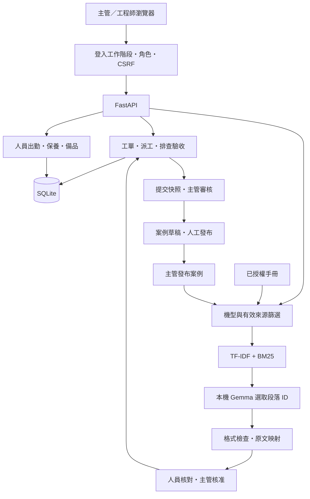

# PredictFix AI｜智慧工廠維修 Copilot

> **CNC 換刀卡住了。該先查什麼、派誰處理，以及怎麼確認真的修好了？**

PredictFix AI 將維修知識查找、資格與容量派工、排查驗收及案例累積接成一套可操作的維修管理系統，面向 CNC 工廠的主管與維修工程師。

**[本機體驗](#快速開始) · [操作手冊](docs/repair-flow.md) · [系統架構](docs/system-architecture.md) · [安全測試](docs/security-testing.md)**

**已驗證成果：68 項自動化測試通過，零跳過；完整展示流程已跑通。** 2026-10-07 已完成獨立本機部署與備份還原檢查；2026-10-15 本機模型改用 Gemma 4 E2B 後重跑 45 個安全檢查全數通過，包含 8 個本機模型攻擊情境。詳見下方測試與限制。

## 目前做到哪裡

| 項目 | 狀態 | 可以如何理解 |
|---|---|---|
| 展示模式 | 已實作並完成本機驗證 | 虛構設備、示範手冊、主管／工程師快速體驗，使用獨立展示資料庫。 |
| 正式資料模式 | 已實作並完成隔離測試與本機檢查 | 從空資料庫建立設備、帳號、出勤、工單與授權手冊；不載入展示資料，不提供快速登入。 |
| 本機運行 | 已恢復並驗證 | SQLAlchemy 改採官方支援的純 Python 安裝，展示及正式資料模式皆通過健康檢查。 |
| 獨立本機部署 | 已運行於 8084 | 檔案雜湊快照、隔離 SQLite、正式登入、重啟及備份還原通過；不是公開網站。 |
| LoRA 小規模訓練 | 已完成並部署獨立實驗 API | Qwen3-0.6B，12 步 CPU 訓練；保留測試 9／12 題符合，資料不足 3 題皆失敗，未替換正式模型。 |
| 可重複展示 | 已提供準備工具與展示腳本 | 專用設備、工程師、資格與出勤；驗收阻擋、主管審核、案例發布與檢索已跑通。 |
| CI | GitHub Actions 通過 | 每次推送與 PR 執行全套測試及容器檢查兩個 job；[執行紀錄](https://github.com/mina201199/predictfix-ai-factory/actions/runs/38715442505)。 |
| Docker／PostgreSQL／HTTPS | Docker 映像已實際啟動驗證；PostgreSQL／HTTPS 尚未實測 | CI 每次建置映像並以正式模式（SQLite）啟動，檢查健康狀態、頁面資產與匿名阻擋；Compose 的 PostgreSQL 與 Caddy TLS 仍待驗收。 |
| 公開網站／企業上線 | 尚未完成 | 尚無外部可用網址，未接真實感測器，未完成工廠現場驗收。 |

**目前定位是具備資料保存與權限流程的本機 MVP。** 「正式資料模式」是應用程式的運行模式，不代表已部署到正式伺服器。

## 解決什麼問題

一次維修通常需要跨越三種資訊：手冊裡的排查依據、人員的資格與可用時間，以及工單中的量測和復測結果。這些資料若分散在文件與口頭交接中，就難以回答「為什麼這樣修」和「憑什麼結案」。

本專案把它們接在同一張工單上，交付以下能力：

| 交付物 | 使用者得到什麼 | 驗證依據 |
|---|---|---|
| **有來源的排查依據** | 依機型查找手冊與已發布案例，查看來源版本及原文，交由主管核准清單。 | 有效引用映射、錯誤引用拒絕、撤回資料排除測試；[檢索報告](artifacts/retrieval-eval-report.json)。 |
| **可解釋的工程師推薦** | 根據技能、必要資格、出勤及剩餘容量比較人選，由主管確認派工。 | 資格／出勤阻擋、容量檢查、SQLite 並發派工測試。 |
| **有證據的驗收與案例** | 逐項記錄結果；驗收通過才可提交，主管可退回重修；完成案件可整理成案例。 | 驗收阻擋、提交快照、重修歷程、案例發布與資料保存測試。 |

日常操作另涵蓋設備與帳號建檔、定期保養到期清單、備品入庫／領用／退料、照片與量測、實際工時紀錄。尚未量測節省多少工時或降低多少停機損失。

## Demo：從換刀卡住到留下維修案例

[](docs/media/predictfix-demo.mp4)

**[▶ 觀看 60 秒完整影片（含中文旁白）](docs/media/predictfix-demo.mp4)**：本機展示模式實機錄影，涵蓋報修補問、核准清單、資格派工、驗收阻擋、主管審核與案例發布。


*實際系統截圖；設備、工單與手冊均為虛構展示資料。*


展示情境：「CNC-03 換刀卡住，只發生在特定刀位」。

1. **補齊條件**：填寫機型、警報、發生條件與已查項目，查看缺少哪些資訊。
2. **核對依據**：比較候選手冊與案例的原文，主管核准排查及驗收清單。
3. **決定派工**：設定必要資格與剩餘估時，查看誰合資格、有出勤且有容量。
4. **執行與復測**：切換被指派的工程師，逐項記錄；驗收未通過時，系統阻擋提交。
5. **審核與累積**：主管核對證據，可退回重修；通過案件整理成案例，人工核對後發布。

展示前執行 `scripts/prepare_interview_demo.py`，即可準備專用工程師、資格、當日出勤與已指派工單。[2–3 分鐘展示腳本](docs/interview-demo.md) 提供操作順序與完整流程驗證方式；完整操作見 [操作手冊](docs/repair-flow.md)。目前補問採結構化欄位檢查；比較的是候選來源，尚未自動產生完整維修方案。

## 用了哪些技術，以及為什麼

| 環節 | 技術選擇 | 設計理由與取捨 |
|---|---|---|
| **前端** | HTML／CSS／JavaScript | 直接呈現角色、工單狀態與來源，讓完整操作流程容易追查；未使用大型前端框架。 |
| **API 與資料** | FastAPI、Pydantic、SQLAlchemy；本機 SQLite | 驗證輸入、維持一致 API 契約並保存工單；SQLite 降低單機啟動成本，高並發與 PostgreSQL 仍需另行驗證。 |
| **知識檢索** | TF-IDF＋BM25 排名融合 | 支援機型、術語與錯誤碼的字詞檢索；合成題比較三種方法目前同分，尚無證據顯示融合更準。未使用 Embedding 或 Vector DB。 |
| **本機 AI** | Gemma 4 E2B Q8_0（Google，Apache 2.0）、llama.cpp 純 CPU；另支援 Ollama | 用小模型選取來源段落；模型不負責自動派工、結案或核准復機。模型不可用時退回候選來源。不需 GPU，選型依據見 [本機模型基準](docs/local-llm-benchmark.md)。 |
| **工程師推薦** | 規則篩選與排序 | 必要資格、出勤與容量是可核對的條件；目前沒有可用來訓練推薦模型的現場成效資料。 |
| **一致性與權限** | 工作階段、角色、CSRF、版本檢查、冪等請求 | 限制操作身分，避免重送造成重複工單或扣帳，拒絕過期版本覆寫。 |
| **部署** | Docker Compose、PostgreSQL、Caddy 設定 | 分開配置 API、資料庫、模型與 HTTPS；目前是待驗證的部署路徑。 |

## 架構



後端控制流程與資料修改，模型只提供受限的摘錄建議。來源、清單版本、提交結果與審核紀錄各自保存，以便追查一次維修的判斷依據。

主要模組：

| 路徑 | 責任 |
|---|---|
| [backend/maintenance_ai.py](backend/maintenance_ai.py) | 手冊版本、檢索、段落引用、案例草稿與發布。 |
| [backend/repair_flow.py](backend/repair_flow.py) | 報修補問、核准清單、逐項結果、保養與備品異動。 |
| [backend/workforce.py](backend/workforce.py) | 帳號、資格、出勤、工時、派工容量核對。 |
| [backend/auth.py](backend/auth.py) · [backend/evidence.py](backend/evidence.py) | 登入權限、照片與量測證據。 |
| [tests/](tests) · [scripts/](scripts) | 隔離測試、模型／檢索評估、安全報告與備份工具。 |

完整資料流與介面邊界見 [系統架構](docs/system-architecture.md)。

## 工程亮點

**1. 把 AI 引用交給程式驗證。**

模型只能回傳段落 ID，後端檢查欄位、型別、數量及 ID 是否存在，再從來源取出原文。捏造引用或不合法格式會降級，不把自由生成文字當成維修步驟。來源存在仍不等於診斷正確，主管必須核對適用性。

**2. 推薦與實際派工各檢查一次。**

介面上的推薦可能過期；正式模式派工 API 再核對資格與剩餘容量。SQLite 並發指派已測，避免兩次操作同時把容量用掉；PostgreSQL 的並發路徑尚未驗收。

**3. 結案是一段可回看的流程。**

附清單的工單必須完成排查與驗收才能提交。提交保存當時的來源與結果快照；退回重修要求重新記錄，前次證據仍保留。既有未附清單工單維持原提交規則。

**4. 用攻擊測試重現並修正資料讀取缺口。**

新增安全測試先重現草稿／撤回資料被工程師讀取、已發布案例暴露原始快照、驗證錯誤回傳密碼等問題，再修正權限與輸出。模型攻擊測試同時核對身分與案例狀態，避免只看回答文字就判定安全。

**5. 日常操作也處理重送與並發。**

保養計畫避免重複生成進行中工單；備品領用在 SQLite 內串行核對並扣帳，相同請求不重複扣庫存。低庫存與保養提醒目前呈現在系統內，未接外部通知或採購。

## 驗證成果與適用邊界

| 驗證項目 | 現有結果 | 能證明什麼／不能證明什麼 |
|---|---|---|
| **功能與整合測試** | 68 項 pytest 通過、零跳過，2026-10-19 | 涵蓋權限、派工、驗收、重修、保養、庫存、備份、持久化、展示、LoRA 分組／評分器、引用截斷、檢索快取與工單分頁；不能代表工廠現場驗收。 |
| **重新安裝驗證** | GitHub Actions 從乾淨 Git checkout 安裝固定依賴，通過 60 項測試 | 驗證依賴安裝可在另一台機器重現；CI 為 Ubuntu，尚未驗證 Windows 的 `setup.ps1` 安裝流程。 |
| **AI／API 安全** | 45／45 個檢查通過（2026-10-15，Gemma 4 E2B），其中含 8 個真實本機模型攻擊情境 | 測提示詞注入、越權、敏感資料暴露與捏造引用；是有限情境驗證，未完成全面滲透測試。 |
| **檢索方法比較** | 16 題正例 Top-3 命中 15 題（93.75%）；4 題負例均無結果 | TF-IDF、BM25、融合方法同分；開發用合成題，不是獨立保留集，也不是 AI 回答正確率。 |
| **完整展示流程** | 驗收失敗阻擋、復測提交、主管審核、案例發布及再檢索通過 | [流程報告](artifacts/interview-walkthrough-report.json) 是 API 操作證據；[60 秒操作影片](docs/media/predictfix-demo.mp4)為本機展示模式錄影。 |
| **正式資料模式** | 2026-10-07 本機 API、空資料庫、展示功能隔離與模型連線通過 | [本機驗證報告](artifacts/production-live-check.json)；不等於公網或企業上線。 |

[安全測試說明](docs/security-testing.md) · [逐項安全報告](artifacts/security-test-report.json) · [檢索報告](artifacts/retrieval-eval-report.json)

本次交付狀態與尚未驗證的項目見 [交付檢查報告](artifacts/interview-readiness-report.json)。

## 本機部署與 LoRA 微調實驗

<!-- experiment-results:start -->
**本機部署：deployed。** 正式資料模式已在 `http://127.0.0.1:8084` 運行，採獨立資料庫與具有檔案雜湊的版本快照。

已驗證登入與主管權限、匿名阻擋、關閉快速登入、重啟後帳號保存，以及 SQLite 備份／新庫還原與工作階段撤銷。尚未部署公網；Docker 映像已由 CI 以正式模式實際啟動驗證，PostgreSQL／HTTPS 尚未實測。

**LoRA 任務：根據報修問題與候選原文，選取相關段落 ID；無依據時輸出空清單。** 資料為 44 題原創虛構案例，按來源主題分組，訓練／驗證／測試為 24／8／12 題。

實驗狀態：`completed`；模型：`Qwen/Qwen3-0.6B`；run：`cpu-smoke-v1`。

| 同一組 12 題來源主題保留測試 | 原模型 | LoRA 模型 |
|---|---:|---:|
| 段落集合完全符合 | 0.0% | 75.0% |
| 選取 Precision | 0.0% | 100.0% |
| 選取 Recall | 0.0% | 100.0% |
| 合法輸出 | 0.0% | 75.0% |
| 資料不足判斷 | 0.0% | 0.0% |
| 文件注入題正確選取 | 0.0% | 100.0% |
| 平均生成耗時（CPU） | 9.45 秒 | 5.53 秒 |

CPU float32、LoRA rank 4、q_proj/v_proj、batch 1，共 12 步；僅訓練 573,440 個參數。訓練耗時 187.4 秒。

Exact match 變化：**+75.0 個百分點**。這是小規模流程實驗，不能證明現場維修成效；訓練 loss、逐題原始輸出、版本與雜湊均保存。

本實驗使用 Transformers、無 JSON grammar，嚴格拒絕 Markdown 包住的 JSON；現有 llama.cpp 服務有格式約束，這些數字不等於線上服務正確率。生成耗時也受回答長度影響。

**目前保留原服務模型，未自動替換。** 此 adapter 尚未完成量化部署、安全回歸與專家評估。

**失敗分析：3 題資料不足題未正確拒答。** 例如輸出 `{"selected":[""]}`，包含不存在的段落 ID；仍須由後端拒絕與降級。此結果尚不符合替換現有模型的條件。

**adapter 推論服務已部署於 `http://127.0.0.1:8085`。** 已重新載入保存的權重，驗證同題原始輸出一致與錯誤輸入拒絕；這是獨立實驗 API，尚未接入正式維修流程。詳見 [推論部署報告](artifacts/lora-serving-report.json)。

[實驗方法與重跑](docs/lora-training.md) · [部署報告](artifacts/local-deployment-report.json) · [LoRA 完整報告](artifacts/lora-training-report.json) · [資料集](training/selection-dataset.json)
<!-- experiment-results:end -->

### 另外做的 ML 實驗：公開軸承故障分類

使用 CWRU 12 kHz 實驗資料，抽取 14 個時域／頻域特徵，以決策樹分類滾珠、內圈與外圈故障。依負載切分：0／1 hp 訓練、2 hp 驗證、3 hp 測試。

跨負載測試 Accuracy **66.7%**、Macro-F1 **0.556**，內圈類別 Recall **0**，顯示目前模型的泛化不足。保留混淆矩陣與逐類結果，供後續改進；不將此結果換算成 CNC 健康度或故障風險。

資料沒有正常類別，測試只有 3 個獨立檔案，同檔視窗彼此相關。這是獨立的分類實驗，尚未串成現場預測維護。完整內容見 [模型評估報告](artifacts/model-report.json)。

## 快速開始

在 Windows 專案根目錄執行；原始開發環境為 Python 3.12。

```powershell
.\setup.ps1

# 展示模式：虛構資料與角色快速體驗
.\start.ps1 -Demo -Port 8082

# 或正式資料模式：空資料庫與真實帳號登入
.\start-production.ps1 -Port 8083
```

| 入口 | 用途 |
|---|---|
| http://127.0.0.1:8082/workflow.html | 展示報修、排查驗收、保養與備品。 |
| http://127.0.0.1:8082/knowledge.html | 手冊、案例與維修 Copilot。 |
| http://127.0.0.1:8083/ | 正式資料模式的設備、帳號、出勤與工單工作台。 |
| http://127.0.0.1:8082/docs | 本機 Swagger API 文件，僅展示模式提供；正式模式不公開。 |

**以上都是本機網址，外部訪客無法直接開啟。** 安裝工具使用 SQLAlchemy 純 Python 建置並檢查依賴及 SQLite 讀寫；啟動時也會先檢查環境。

服務啟動後另開終端機，準備面試工單：

```powershell
.\.venv\Scripts\python.exe scripts/prepare_interview_demo.py
```

登入畫面會新增「以面試示範工程師體驗」。重跑沿用未完成的示範工單，不清空既有資料。詳見 [面試展示指南](docs/interview-demo.md)。

本機 LLM 與軸承回放為額外安裝項目：

```powershell
.\.venv\Scripts\python.exe scripts\setup_local_llm.py
.\.venv\Scripts\python.exe scripts\prepare_model.py
```

沒有模型服務時，知識中心仍可顯示候選來源，並標示未執行模型。第一次建檔、登入資訊及套件安裝見 [本機安裝指南](docs/local-setup.md)；備份與部署見 [正式環境手冊](docs/production-setup.md)。

## 重跑測試

```powershell
.\.venv\Scripts\python.exe -m pytest -q
.\.venv\Scripts\python.exe scripts\run_security_checks.py
# 另測真實本機模型（Gemma 4 E2B），需先啟動 8081 模型服務
.\.venv\Scripts\python.exe scripts\run_security_checks.py --live
```

測試建立隔離 SQLite，不寫入運行中的正式資料庫。pytest 的 68 項測試與安全報告的 45 個情境檢查是不同計數，不能直接相加。CI 另解析 JUnit，拒絕零測試或跳過測試的結果。

## 下一步

| 優先序 | 要補的工作 | 完成判準 |
|---|---|---|
| **1．交付紀錄** | 已完成：GitHub Actions 測試與容器檢查通過，見 [執行紀錄](https://github.com/mina201199/predictfix-ai-factory/actions/runs/38553389662)。 | GitHub 確實跑完測試與容器檢查。 |
| **2．展示影片** | 已完成：[60 秒操作影片](docs/media/predictfix-demo.mp4)涵蓋報修、派工、驗收阻擋、審核與案例發布。 | 面試官能快速看完操作，現場也可重新準備工單。 |
| **3．外部可用** | 實測 Docker／PostgreSQL／HTTPS，建立獨立的公開展示環境。 | 外部可開啟、資料可持久化、重啟與備份還原通過；展示與正式資料隔離。 |
| **4．效果評估** | 建立獨立手冊題集與相關性標註；由領域人員評估引用適用性和流程成效。 | 有獨立測試集、逐題錯誤分析與清楚的成效指標。 |

尚未完成：PLC／感測器接入、健康度與剩餘壽命預測、PDF／OCR、企業 SSO、多租戶隔離、ERP／人事串接及工廠現場驗收。

## 深入閱讀

| 文件 | 內容 |
|---|---|
| [操作手冊](docs/repair-flow.md) | 報修、清單、派工、驗收、保養與備品。 |
| [面試展示指南](docs/interview-demo.md) | 一鍵準備、2–3 分鐘腳本、流程驗證與 CI 邊界。 |
| [本機部署與 LoRA 實驗](docs/lora-training.md) | 部署快照、資料分組、CPU 訓練、基準比較與適用限制。 |
| [系統架構](docs/system-architecture.md) | 資料流、API、來源管理與實作邊界。 |
| [安全測試](docs/security-testing.md) | 攻擊情境、發現與修正、重跑方式及限制。 |
| [權限設計與矩陣](docs/access-control.md) | 主管／工程師權限劃分、資料歸屬、職責分離、逐路由權限矩陣與面試問答。 |
| [本機安裝](docs/local-setup.md) · [正式環境與部署](docs/production-setup.md) | 安裝、帳號、出勤、備份還原及伺服器設定。 |
| [歷史開發紀錄](docs/development-history.md) | 過往實作與驗證紀錄，含已被後續版本更新的內容。 |
| [外部工單介接](docs/ticket-integration.md) · [驗收結果](docs/ticket-integration-validation.md) | API 契約、CSV、主管管理頁面與本機模擬器；尚未串接企業系統。 |
