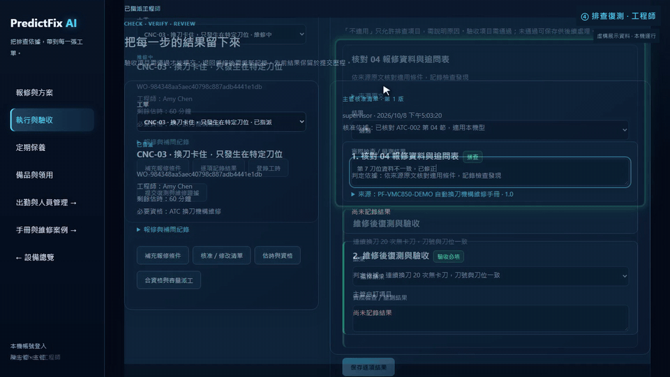
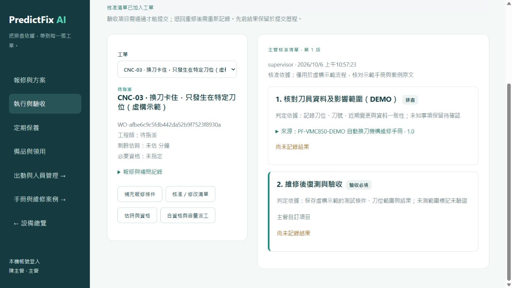
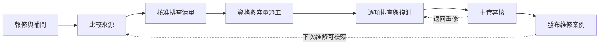
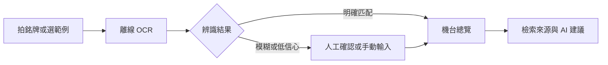
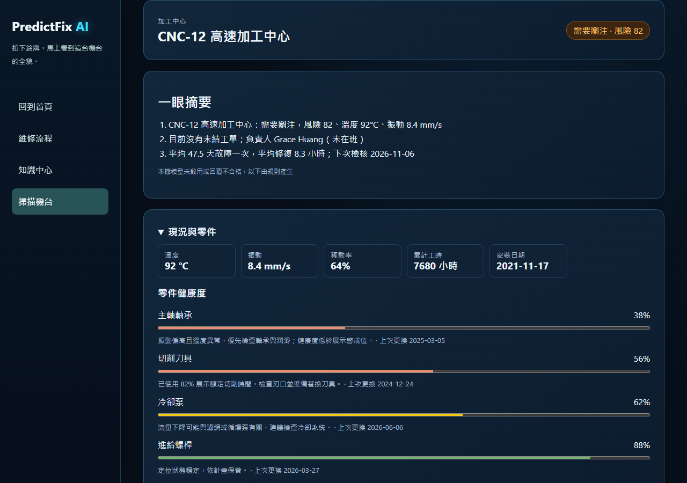
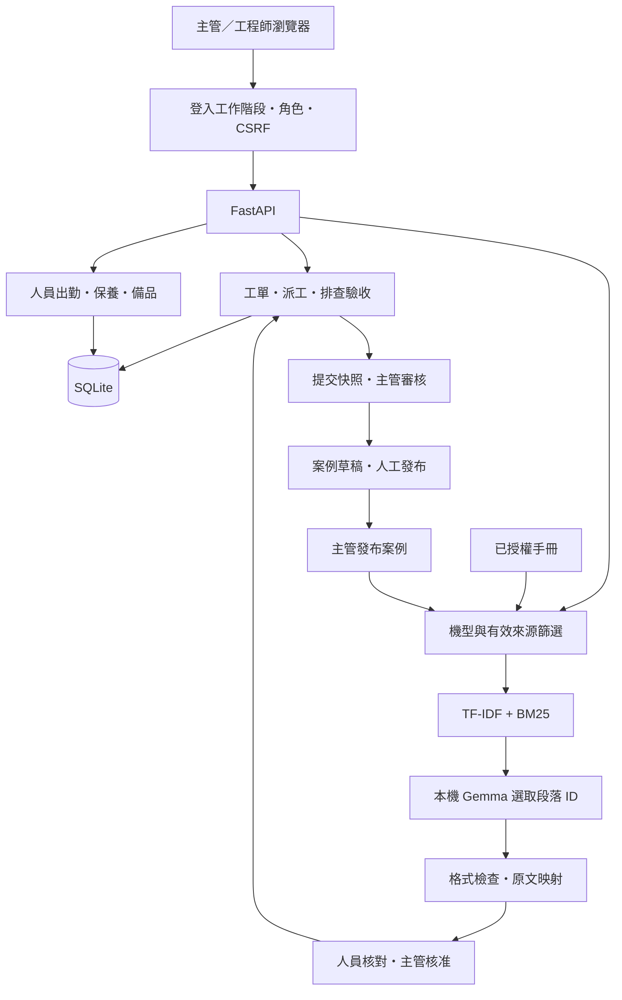

# PredictFix AI｜智慧工廠維修 COPILOT

> **CNC 換刀卡住了。該先查什麼、派誰處理，以及怎麼確認真的修好了？**

PredictFix AI 將維修知識查找、資格與容量派工、排查驗收及案例累積接成一套可操作的維修管理系統，面向 CNC 工廠的主管與維修工程師。

**[直接開啟面試展示](https://predictfix-mobile-demo.ruru0109lee.chatgpt.site) · [三分鐘操作指南](docs/interview-demo.md) · [本機體驗](#快速開始) · [操作手冊](docs/repair-flow.md) · [系統架構](docs/system-architecture.md) · [安全測試](docs/security-testing.md)**

**已驗證成果：161 項自動化測試通過，零跳過（2026-10-20 乾淨環境實跑）；完整展示流程已跑通。** 2026-10-07 已完成獨立本機部署與備份還原檢查；2026-10-15 本機模型改用 Gemma 4 E2B 後重跑 45 個安全檢查全數通過，包含 8 個本機模型攻擊情境。詳見下方測試與限制。

本次版本整合、本機完整回歸與 CI 範圍見 [2026-10-20 交付驗證](docs/release-validation-20261020.md)。

## 目前做到哪裡

| 項目 | 狀態 | 可以如何理解 |
|---|---|---|
| 展示模式 | 已實作並完成本機驗證 | 虛構設備、示範手冊、主管／工程師快速體驗，使用獨立展示資料庫。 |
| 正式資料模式 | 已實作並完成隔離測試與本機檢查 | 從空資料庫建立設備、帳號、出勤、工單與授權手冊；不載入展示資料，不提供快速登入。 |
| 本機運行 | 已恢復並驗證 | SQLAlchemy 改採官方支援的純 Python 安裝，展示及正式資料模式皆通過健康檢查。 |
| 獨立本機部署 | 曾於 8084 驗證，非即時服務狀態 | 檔案雜湊快照、隔離 SQLite、正式登入、重啟及備份還原的歷史紀錄；不是公開網站。 |
| LoRA 小規模訓練 | 已完成並部署獨立實驗 API | Qwen3-0.6B，12 步 CPU 訓練；保留測試 9／12 題符合，資料不足 3 題皆失敗，未替換正式模型。 |
| Gemma QLoRA | 504 步實驗完成，尚不採用 | 新 100 題合成評估完全正確率 42%、recall 50.77%，三段答案 0/20；最新結果來自獨立訓練分支，沒有替換現用 Q8_0 模型。見 [面試證據](docs/interview-readiness.md)。 |
| 外部工單介接 | API／CSV／outbox 已實作 | 本機模擬器及隔離測試已驗證；正式 Compose 已含 worker，尚未對接真實企業端點。 |
| 維修知識圖譜 | 可追溯關係、審查與獨立查詢已實作 | 有合成來源覆蓋評估；一般 AI 查詢尚未直接使用圖譜，未經領域專家及現場成效驗收。 |
| 可重複展示 | 已提供準備工具與展示腳本 | 專用設備、工程師、資格與出勤；驗收阻擋、主管審核、案例發布與檢索已跑通。 |
| CI | PR #11 合併後 main 三個 job 全數通過（2026-10-21） | 全套 161 項測試、正式／展示容器與 PostgreSQL 驗證成功。[執行紀錄](https://github.com/mina201199/predictfix-ai-factory/actions/runs/39509848713)；早期整合範圍見 [交付驗證](docs/release-validation-20261020.md)。 |
| Docker／PostgreSQL／HTTPS | Docker 與 PostgreSQL 17 有歷史實測；本機 TLS 曾有交接紀錄 | 並發派工、正式模式、維修流程三個情境在 PostgreSQL 上通過；Compose 正式模式「API＋PostgreSQL」通過健康檢查、重啟後資料保存，`pg_dump` 備份可還原到新資料庫並撤銷工作階段。CI 每次重跑。本 repo 缺完整 TLS 原始輸出，手機與企業 HTTPS 仍待驗收，見 [交接紀錄](docs/interview-handoff-20261021.md)。 |
| 公開面試展示 | 已公開（2026-10-21） | 免登入觀看實機影片與三分鐘操作指南，可用手機或電腦體驗虛構維修流程。[交付驗證](docs/showcase-delivery-20261021.md)。 |
| 正式後端／企業上線 | 尚未完成 | 正式後端尚無外部可用網址，未接真實感測器，未完成工廠現場驗收。 |

**目前定位是具備資料保存與權限流程的本機 MVP。** 「正式資料模式」是應用程式的運行模式，不代表已部署到正式伺服器。

## 解決什麼問題

一次維修通常需要跨越三種資訊：手冊裡的排查依據、人員的資格與可用時間，以及工單中的量測和復測結果。這些資料若分散在文件與口頭交接中，就難以回答「為什麼這樣修」和「憑什麼結案」。

本專案把它們接在同一張工單上，交付以下能力：

| 交付物 | 使用者得到什麼 | 驗證依據 |
|---|---|---|
| **有來源的排查依據** | 依機型查找手冊與已發布案例，查看來源版本及原文，交由主管核准清單。 | 有效引用映射、錯誤引用拒絕、撤回資料排除測試；[檢索報告](artifacts/retrieval-eval-report.json)。 |
| **可解釋的工程師推薦** | 根據技能、必要資格、出勤及剩餘容量比較人選，由主管確認派工。 | 資格／出勤阻擋、容量檢查、SQLite 並發派工測試。 |
| **有證據的驗收與案例** | 逐項記錄結果；驗收通過才可提交，主管可退回重修；完成案件可整理成案例。 | 驗收阻擋、提交快照、重修歷程、案例發布與資料保存測試。 |

日常操作另涵蓋設備與帳號建檔、定期保養到期清單、備品入庫／領用／退料、照片與量測、實際工時紀錄。尚未量測節省多少工時或降低多少停機損失。

## Demo：從換刀卡住到留下維修案例

[](docs/media/predictfix-demo.mp4)

**[▶ 觀看 60 秒完整影片（含中文旁白）](docs/media/predictfix-demo.mp4)**：本機展示模式實機錄影，涵蓋報修補問、核准清單、資格派工、驗收阻擋、主管審核與案例發布。



*實際系統截圖；設備、工單與手冊均為虛構展示資料。*



展示情境：「CNC-03 換刀卡住，只發生在特定刀位」。

1. **補齊條件**：填寫機型、警報、發生條件與已查項目，查看缺少哪些資訊。
2. **核對依據**：比較候選手冊與案例的原文，主管核准排查及驗收清單。
3. **決定派工**：設定必要資格與剩餘估時，查看誰合資格、有出勤且有容量。
4. **執行與復測**：切換被指派的工程師，逐項記錄；驗收未通過時，系統阻擋提交。
5. **審核與累積**：主管核對證據，可退回重修；通過案件整理成案例，人工核對後發布。

展示前執行 `scripts/prepare_interview_demo.py`，即可準備專用工程師、資格、當日出勤與已指派工單。[2–3 分鐘展示腳本](docs/interview-demo.md) 提供操作順序與完整流程驗證方式；完整操作見 [操作手冊](docs/repair-flow.md)。目前補問採結構化欄位檢查；比較的是候選來源，尚未自動產生完整維修方案。

## 機台銘牌掃描 Demo

開啟 `/scan.html`，拍攝或上傳銘牌照片，由離線 OCR 讀出設備編號，再整合現況、零件健康、負責人與出勤、進行中的工作、歷史檢修、保養排程、備品與可靠度指標。未接感測器的數值是展示資料；正式模式缺資料時顯示「尚無資料」。



OCR 使用 RapidOCR 3.10.0、ONNX Runtime 1.31.0 的 CPU 模型，模型隨套件安裝，執行時不需連外網。信心達 0.85 且候選差距至少 0.10 才自動開啟；模糊比對即使分數高也要確認。模型摘要會附上實際存在的來源編號；模型未啟動、逾時或格式不合格時改為「規則產生」。來源存在不代表建議內容已經過工程師驗證，仍需人工核對。

2026-10-19 的 [OCR 評估報告](artifacts/ocr-eval-report.json) 包含 18 台設備 × 5 種變化，共 90 張**合成銘牌**。乾淨、透視、模糊、反光、低對比版本均為 top-1 100%，自動開錯台 0 次；這不代表真實工廠照片的準確率。可用以下指令重跑：

```powershell
.\.venv\Scripts\python.exe scripts\evaluate_ocr.py
```



[手機版畫面](docs/images/machine-scan-mobile.png)。

準備歷史檢修展示資料（只可對 demo 資料庫執行；重跑不重複新增）：

```powershell
$env:APP_MODE='demo'
.\.venv\Scripts\python.exe scripts\seed_machine_history.py
.\start.ps1 -Demo
```

開啟 `http://127.0.0.1:8080/scan.html`，點 CNC-07 範例銘牌，應自動看到機台總覽、負責人、維修中的工作與歷史檢修；展開各區段查看細節。範例也會實際執行 OCR。上傳沒有文字的照片，應聚焦到手動輸入欄；輸入 `cnc-12` 應找到 CNC-12。18 張範例與可列印總表位於 [artifacts/demo-nameplates](artifacts/demo-nameplates/)，頁面截圖可由瀏覽器在總覽顯示後擷取。

目前以手機操作展示。手機與筆電連同一個內網 Wi-Fi，再執行：

```powershell
.\start.ps1 -Demo -Lan
```

終端機會印出 `http://<筆電 IPv4>:8080/scan.html`。區網模式關閉免密碼登入，使用既有帳密；首次建立帳號時可在環境變數或未追蹤的 `.env` 設 `BOOTSTRAP_PASSWORD`，既有帳號不會重設。未設定初始密碼的展示帳號資訊在 `data/initial-accounts.json`（已忽略）。照片由檔案輸入的 `capture` 呼叫相機，實際行為依手機瀏覽器而異；檔案上傳可作備案。此 HTTP 模式適合受信任的展示內網；本機 TLS 曾有交接紀錄，手機與企業 HTTPS 環境仍待驗收。

若 Windows 防火牆擋住連線，由使用者自行以系統管理員執行以下指令；啟動腳本只顯示指令，不會修改防火牆：

```powershell
New-NetFirewallRule -DisplayName "PredictFix LAN demo" -Direction Inbound -Protocol TCP -LocalPort 8080 -Profile Private -Action Allow
```

實體手機的連線與拍攝仍待裝置實測；Getac 工業平板僅列入未來選型評估，不屬於目前展示範圍。瀏覽器測試已覆蓋手機版 375×812 與桌面版、範例辨識、無文字圖片及手動輸入。另以 `node tests/scan_race.cjs` 檢查舊 OCR 回應不會蓋掉使用者後續選擇。

面試說法：「目前以響應式網頁展示，先驗證拍照、離線 OCR、維修資料整合與附來源的 AI 建議。後續可用 Capacitor 包裝成 App，或以原生 App 接同一套 API，再整合工業平板掃描器、MDM 派送與離線快取。」這些 App 能力是後續規劃。

## 用了哪些技術，以及為什麼

| 環節 | 技術選擇 | 設計理由與取捨 |
|---|---|---|
| **前端** | HTML／CSS／JavaScript | 直接呈現角色、工單狀態與來源，讓完整操作流程容易追查；未使用大型前端框架。 |
| **銘牌影像辨識** | RapidOCR、ONNX Runtime、Pillow | 本機 CPU 偵測與辨識文字，比對已建檔機台；低信心交由人確認。模型隨套件安裝，不依賴外部 API。 |
| **API 與資料** | FastAPI、Pydantic、SQLAlchemy；本機 SQLite、部署 PostgreSQL 17 | 驗證輸入、維持一致 API 契約並保存工單；SQLite 降低單機啟動成本，PostgreSQL 已用相同情境實測，高並發負載仍需另行壓測。 |
| **知識檢索** | TF-IDF＋BM25；選配 OpenAI Embedding 排名融合 | 本機字詞檢索支援機型、術語與錯誤碼。啟用 OpenAI 且來源獲授權時可加入向量排序；未使用獨立 Vector DB。舊合成題報告只比較字詞方法，不代表向量檢索成效。 |
| **本機 AI** | Gemma 4 E2B Q8_0（Google，Apache 2.0）、llama.cpp 純 CPU；另支援 Ollama | 知識中心由模型選段；浮動助手以 RAG 整理白話建議、引用與操作草稿。操作須人工確認並通過後端權限檢查，模型不核准復機。模型不可用時明示未取得有效模型結果。不需 GPU，選型依據見 [本機模型基準](docs/local-llm-benchmark.md) 與 [模型選型與合規](docs/model-selection.md)。 |
| **工程師推薦** | 規則篩選與排序 | 必要資格、出勤與容量是可核對的條件；目前沒有可用來訓練推薦模型的現場成效資料。 |
| **一致性與權限** | 工作階段、角色、CSRF、版本檢查、冪等請求 | 限制操作身分，避免重送造成重複工單或扣帳，拒絕過期版本覆寫。 |
| **部署** | Docker Compose、PostgreSQL、Caddy 設定 | 分開配置 API、資料庫、模型與 HTTPS；API＋PostgreSQL 有實測紀錄；本機 TLS 與正式環境驗收的界線見 [面試交接](docs/interview-handoff-20261021.md)。 |

### 模型選型與合規

本機模型使用 Google 的 Gemma 4 E2B Q8_0（Apache 2.0），在本機 CPU 執行；除選配的 OpenAI 整合外，工單與手冊不會送出工廠。原本的 Qwen3-0.6B 已於 2026-10-15 淘汰，原因有二：44 題段落選取基準只選對 22.7%（Gemma 為 100%），以及台灣案場對中國開發模型的合規疑慮。台灣自製備案為聯發創新基地的 Llama-Breeze2-3B（選對 88.6%，注入題較弱）。來源、授權、離線與檢核清單見 [模型選型與合規](docs/model-selection.md)。

## 架構



後端控制流程與資料修改，模型只提供受限的摘錄建議。來源、清單版本、提交結果與審核紀錄各自保存，以便追查一次維修的判斷依據。

主要模組：

| 路徑 | 責任 |
|---|---|
| [backend/maintenance_ai.py](backend/maintenance_ai.py) | 手冊版本、檢索、段落引用、案例草稿與發布。 |
| [backend/repair_flow.py](backend/repair_flow.py) | 報修補問、核准清單、逐項結果、保養與備品異動。 |
| [backend/workforce.py](backend/workforce.py) | 帳號、資格、出勤、工時、派工容量核對。 |
| [backend/auth.py](backend/auth.py) · [backend/evidence.py](backend/evidence.py) | 登入權限、照片與量測證據。 |
| [tests/](tests) · [scripts/](scripts) | 隔離測試、模型／檢索評估、安全報告與備份工具。 |

完整資料流與介面邊界見 [系統架構](docs/system-architecture.md)。

## 工程亮點

**1. 把 AI 引用交給程式驗證。**

模型只能回傳段落 ID，後端檢查欄位、型別、數量及 ID 是否存在，再從來源取出原文。捏造引用或不合法格式會降級，不把自由生成文字當成維修步驟。來源存在仍不等於診斷正確，主管必須核對適用性。

**2. 推薦與實際派工各檢查一次。**

介面上的推薦可能過期；正式模式派工 API 再核對資格與剩餘容量。SQLite 與 PostgreSQL 的並發指派都已實測，避免兩次操作同時把容量用掉。

**3. 結案是一段可回看的流程。**

附清單的工單必須完成排查與驗收才能提交。提交保存當時的來源與結果快照；退回重修要求重新記錄，前次證據仍保留。既有未附清單工單維持原提交規則。

**4. 用攻擊測試重現並修正資料讀取缺口。**

新增安全測試先重現草稿／撤回資料被工程師讀取、已發布案例暴露原始快照、驗證錯誤回傳密碼等問題，再修正權限與輸出。模型攻擊測試同時核對身分與案例狀態，避免只看回答文字就判定安全。

**5. 日常操作也處理重送與並發。**

保養計畫避免重複生成進行中工單；備品領用在 SQLite 內串行核對並扣帳，相同請求不重複扣庫存。低庫存與保養提醒目前呈現在系統內，未接外部通知或採購。

## 驗證成果與適用邊界

| 驗證項目 | 現有結果 | 能證明什麼／不能證明什麼 |
|---|---|---|
| **功能與整合測試** | 161 項 pytest 通過、零跳過，2026-10-20 乾淨環境實跑 | 涵蓋權限、派工、驗收、重修、保養、庫存、備份、持久化、展示、LoRA 分組／評分器、引用截斷、檢索快取與工單分頁；不能代表工廠現場驗收。 |
| **重新安裝驗證** | 2026-10-20 GitHub Actions 從乾淨 Git checkout 安裝固定依賴，通過 161 項測試 | 驗證依賴安裝可在另一台機器重現；CI 為 Ubuntu，本次 Windows 另建乾淨虛擬環境安裝，但未透過 `setup.ps1`。 |
| **本輪面試回歸** | 161 項 pytest 通過、零失敗／錯誤／跳過，2026-10-21 | 包含 `tests` 與 `tools/demo-video/tests`；增加慢啟動的程序清理測試，沒有重跑 GPU／正式部署。見 [JUnit](artifacts/interview-20261021/tests.xml)。 |
| **AI／API 安全** | 45／45 個檢查通過（2026-10-15，Gemma 4 E2B），其中含 8 個真實本機模型攻擊情境 | 測提示詞注入、越權、敏感資料暴露與捏造引用；是有限情境驗證，未完成全面滲透測試。 |
| **檢索方法比較** | 16 題正例 Top-3 命中 15 題（93.75%）；4 題負例均無結果 | TF-IDF、BM25、融合方法同分；開發用合成題，不是獨立保留集，也不是 AI 回答正確率。 |
| **完整展示流程** | 驗收失敗阻擋、復測提交、主管審核、案例發布及再檢索通過 | [流程報告](artifacts/interview-walkthrough-report.json) 是 API 操作證據；[60 秒操作影片](docs/media/predictfix-demo.mp4)為本機展示模式錄影。 |
| **正式資料模式** | 2026-10-07 本機 API、空資料庫、展示功能隔離與模型連線通過 | [本機驗證報告](artifacts/production-live-check.json)；不等於公網或企業上線。 |

[安全測試說明](docs/security-testing.md) · [逐項安全報告](artifacts/security-test-report.json) · [檢索報告](artifacts/retrieval-eval-report.json)

2026-10-21 面試交付狀態見 [交接清單](docs/interview-handoff-20261021.md)；[舊交付檢查報告](artifacts/interview-readiness-report.json) 保留其原始日期與測試範圍。

## 本機部署與 LoRA 微調實驗

以下自動產生區塊保存歷史 Qwen 實驗；最新 Gemma QLoRA 與現用模型的差異見 [面試回答](docs/interview-readiness.md)，不以本區塊判斷即時服務狀態。

<!-- experiment-results:start -->
**歷史本機部署紀錄：deployed。** 當時在 `http://127.0.0.1:8084` 驗證正式資料模式，採獨立資料庫與具有檔案雜湊的版本快照；不代表該服務現在仍開啟。

已驗證登入與主管權限、匿名阻擋、關閉快速登入、重啟後帳號保存，以及 SQLite 備份／新庫還原與工作階段撤銷。尚未部署公網；Docker 映像已由 CI 以正式模式實際啟動驗證，PostgreSQL 已有重啟保存與 `pg_dump` 還原紀錄。本機 TLS 的後續交接與未驗收範圍見 [面試交接](docs/interview-handoff-20261021.md)；本輪不重跑部署。

**LoRA 任務：根據報修問題與候選原文，選取相關段落 ID；無依據時輸出空清單。** 資料為 44 題原創虛構案例，按來源主題分組，訓練／驗證／測試為 24／8／12 題。

實驗狀態：`completed`；模型：`Qwen/Qwen3-0.6B`；run：`cpu-smoke-v1`。

| 同一組 12 題來源主題保留測試 | 原模型 | LoRA 模型 |
|---|---:|---:|
| 段落集合完全符合 | 0.0% | 75.0% |
| 選取 Precision | 0.0% | 100.0% |
| 選取 Recall | 0.0% | 100.0% |
| 合法輸出 | 0.0% | 75.0% |
| 資料不足判斷 | 0.0% | 0.0% |
| 文件注入題正確選取 | 0.0% | 100.0% |
| 平均生成耗時（CPU） | 9.45 秒 | 5.53 秒 |

CPU float32、LoRA rank 4、q_proj/v_proj、batch 1，共 12 步；僅訓練 573,440 個參數。訓練耗時 187.4 秒。

Exact match 變化：**+75.0 個百分點**。這是小規模流程實驗，不能證明現場維修成效；訓練 loss、逐題原始輸出、版本與雜湊均保存。

本實驗使用 Transformers、無 JSON grammar，嚴格拒絕 Markdown 包住的 JSON；現有 llama.cpp 服務有格式約束，這些數字不等於線上服務正確率。生成耗時也受回答長度影響。

**目前保留原服務模型，未自動替換。** 此 adapter 尚未完成量化部署、安全回歸與專家評估。

**失敗分析：3 題資料不足題未正確拒答。** 例如輸出 `{"selected":[""]}`，包含不存在的段落 ID；仍須由後端拒絕與降級。此結果尚不符合替換現有模型的條件。

**歷史 Qwen adapter 曾在 `http://127.0.0.1:8085` 驗證推論。** 當時重新載入保存權重，驗證同題輸出一致與錯誤輸入拒絕；不代表服務現在仍開啟，也不是最新 Gemma QLoRA 的部署證據。這是獨立實驗 API，尚未接入正式維修流程。詳見 [推論部署報告](artifacts/lora-serving-report.json)。

[實驗方法與重跑](docs/lora-training.md) · [部署報告](artifacts/local-deployment-report.json) · [LoRA 完整報告](artifacts/lora-training-report.json) · [資料集](training/selection-dataset.json)
<!-- experiment-results:end -->

### 另外做的 ML 實驗：公開軸承故障分類

使用 CWRU 12 kHz 實驗資料，抽取 14 個時域／頻域特徵，以決策樹分類滾珠、內圈與外圈故障。依負載切分：0／1 hp 訓練、2 hp 驗證、3 hp 測試。

跨負載測試 Accuracy **66.7%**、Macro-F1 **0.556**，內圈類別 Recall **0**，顯示目前模型的泛化不足。保留混淆矩陣與逐類結果，供後續改進；不將此結果換算成 CNC 健康度或故障風險。

資料沒有正常類別，測試只有 3 個獨立檔案，同檔視窗彼此相關。這是獨立的分類實驗，尚未串成現場預測維護。完整內容見 [模型評估報告](artifacts/model-report.json)。

## 手機互動 Demo

另有適合手機與桌面的獨立展示介面，無須安裝 Python 或模型。包含報修、核對來源、清單核准、資格／出勤／容量派工、逐項排查與驗收、主管審核／退回重修及案例發布。

[開啟公開面試展示](https://predictfix-mobile-demo.ruru0109lee.chatgpt.site)，免登入。首頁有實機影片、逐字稿、三分鐘導覽及操作協助；按「開始互動展示」即可體驗。這是靜態模擬介面，不代表原 FastAPI 系統已完成公網部署。

- 在既有本機服務開啟 `/mobile.html`，或以 `node scripts/serve_mobile_demo.cjs` 啟動獨立預覽，再開啟 `http://127.0.0.1:8096`。
- 點「開始換刀卡住情境」，依畫面引導操作；右上角可切換主管／工程師。
- 工程師可點「填入示範排查紀錄」，再將驗收改為「失敗」，體驗提交阻擋；主管可退回重修，前次提交快照仍會保留。
- 所有設備、手冊摘要、量測與人員均為虛構資料。資料只保存在當前瀏覽器，可用「重設展示」清除；不同手機與電腦不會同步。
- 此介面未連接 FastAPI、現場設備、即時 LLM 或正式資料庫；角色切換僅模擬流程，不是正式登入權限。

內嵌工作台原始檔位於 `sites/predictfix-mobile/dist/`；公開網站另在 Sites 正式原始碼庫維護面試導覽與影片，版本與提交識別見 [交付紀錄](docs/showcase-delivery-20261021.md)。本機 `127.0.0.1` 網址只供該電腦使用；手機遠端體驗請開啟已部署的 HTTPS 網址。

另有本機保存的 60 秒截圖產品介紹；版本內附 [字幕](artifacts/video/AI-Factory-60s-zh-TW.srt)與分鏡。成品位置、雜湊及重製條件見 [影片資產說明](docs/product-video.md)。

## 快速開始

在 Windows 專案根目錄執行；原始開發環境為 Python 3.12。

```powershell
.\setup.ps1

# 展示模式：虛構資料與角色快速體驗
.\start.ps1 -Demo -Port 8082

# 或正式資料模式：空資料庫與真實帳號登入
.\start-production.ps1 -Port 8083
```

| 入口 | 用途 |
|---|---|
| http://127.0.0.1:8082/workflow.html | 展示報修、排查驗收、保養與備品。 |
| http://127.0.0.1:8082/knowledge.html | 手冊、案例與維修 Copilot。 |
| http://127.0.0.1:8083/ | 正式資料模式的設備、帳號、出勤與工單工作台。 |
| http://127.0.0.1:8082/docs | 本機 Swagger API 文件，僅展示模式提供；正式模式不公開。 |

**以上都是本機網址，外部訪客無法直接開啟。** 安裝工具使用 SQLAlchemy 純 Python 建置並檢查依賴及 SQLite 讀寫；啟動時也會先檢查環境。

服務啟動後另開終端機，準備面試工單：

```powershell
.\.venv\Scripts\python.exe scripts/prepare_interview_demo.py
```

登入畫面會新增「以面試示範工程師體驗」。重跑沿用未完成的示範工單，不清空既有資料。詳見 [面試展示指南](docs/interview-demo.md)。

本機 LLM 與軸承回放為額外安裝項目：

```powershell
.\.venv\Scripts\python.exe scripts\setup_local_llm.py
.\.venv\Scripts\python.exe scripts\prepare_model.py
```

沒有模型服務時，知識中心仍可顯示候選來源，並標示未執行模型。第一次建檔、登入資訊及套件安裝見 [本機安裝指南](docs/local-setup.md)；備份與部署見 [正式環境手冊](docs/production-setup.md)。

## 重跑測試

```powershell
.\.venv\Scripts\python.exe -m pytest -q
.\.venv\Scripts\python.exe scripts\run_security_checks.py
# 另測真實本機模型（Gemma 4 E2B），需先啟動 8081 模型服務
.\.venv\Scripts\python.exe scripts\run_security_checks.py --live
```

測試建立隔離 SQLite，不寫入運行中的正式資料庫。

PostgreSQL 另用獨立腳本驗證（不放進 pytest，因為本機不一定有 PostgreSQL，而 CI 拒絕跳過的測試）：

```powershell
# 1. 用完即丟的 PostgreSQL 17，密碼只放在這個終端機的環境變數
$env:PGPASSWORD=[guid]::NewGuid().ToString('N')
docker run --rm -d --name pf-verify-pg -p 127.0.0.1:55432:5432 -e POSTGRES_PASSWORD=$env:PGPASSWORD postgres:17-alpine
# 2. 三個情境各自在新的暫存資料庫執行，結束後刪除
.\.venv\Scripts\python.exe scripts\verify_postgres.py scenarios --admin-url postgresql+psycopg://postgres@127.0.0.1:55432/postgres
docker stop pf-verify-pg
# 3. Compose 正式模式：健康檢查、重啟保存、pg_dump 還原到新資料庫；結束時自動 down -v
.\.venv\Scripts\python.exe scripts\verify_postgres.py container
```

兩個指令最後一行都是 JSON，所有值為 `true` 即通過。pytest 項數、安全情境與模型題數不能直接相加；148 項是 2026-10-19 歷史結果。CI 另解析 JUnit，拒絕零測試或跳過測試的結果。面試前依 [隔離驗證方式](docs/interview-demo.md) 取得當次結果。

## 下一步

| 優先序 | 要補的工作 | 完成判準 |
|---|---|---|
| **1．交付紀錄** | 已完成：GitHub Actions 全套測試、雙模式容器及 PostgreSQL 通過，見 [執行紀錄](https://github.com/mina201199/predictfix-ai-factory/actions/runs/39452377590)。 | 已保存原始測試報告、版本來源與 CI 連結。 |
| **2．展示影片** | 已完成：[60 秒操作影片](docs/media/predictfix-demo.mp4)涵蓋報修、派工、驗收阻擋、審核與案例發布。 | 面試官能快速看完操作，現場也可重新準備工單。 |
| **3．對外展示交付** | 已完成：[公開展示](https://predictfix-mobile-demo.ruru0109lee.chatgpt.site)整合影片、逐字稿與操作指南。 | 已驗證免登入存取、影片完整播放與互動流程，見 [交付紀錄](docs/showcase-delivery-20261021.md)。 |
| **4．公開後端部署** | Docker／PostgreSQL 已有驗證；接續驗收後端 HTTPS 並建立獨立展示環境，補上監控與異地備份演練。 | 外部可登入後端、資料可持久化、重啟與備份還原通過；展示與正式資料隔離。 |
| **5．效果評估** | 建立獨立手冊題集與相關性標註；由領域人員評估引用適用性和流程成效，補測圖譜／外部工單的 PostgreSQL 路徑。 | 有獨立測試集、逐題錯誤分析、資料庫驗收與清楚的成效指標。 |

尚未完成：PLC／感測器接入、現場健康度與剩餘壽命預測、完整 PDF 手冊匯入／OCR、企業 SSO、多租戶隔離、真實 ERP／人事串接及工廠現場驗收。機台銘牌 OCR 已實作並做合成評估，不等於完整 PDF 手冊處理。

## 深入閱讀

| 文件 | 內容 |
|---|---|
| [操作手冊](docs/repair-flow.md) | 報修、清單、派工、驗收、保養與備品。 |
| [面試展示指南](docs/interview-demo.md) | 一鍵準備、2–3 分鐘腳本、流程驗證與 CI 邊界。 |
| [本機部署與 LoRA 實驗](docs/lora-training.md) | 部署快照、資料分組、CPU 訓練、基準比較與適用限制。 |
| [Gemma 固定 SFT 實驗](docs/gemma-sft-protocol.md) · [實測結果](docs/gemma-sft-results-20261019.md) · [重跑與驗證](docs/gemma-sft-running.md) | 官方權重、獨立保留集與 adapter 重載；本次 QLoRA 全部拒答，未達可用的選段改善。 |
| [系統架構](docs/system-architecture.md) | 資料流、API、來源管理與實作邊界。 |
| [安全測試](docs/security-testing.md) | 攻擊情境、發現與修正、重跑方式及限制。 |
| [權限設計與矩陣](docs/access-control.md) | 主管／工程師權限劃分、資料歸屬、職責分離、逐路由權限矩陣與面試問答。 |
| [維修知識圖譜](docs/knowledge-graph.md) | 有來源的候選／核准路徑、主管審查、隔離展示與合成評估。 |
| [本機安裝](docs/local-setup.md) · [正式環境與部署](docs/production-setup.md) | 安裝、帳號、出勤、備份還原及伺服器設定。 |
| [歷史開發紀錄](docs/development-history.md) | 過往實作與驗證紀錄，含已被後續版本更新的內容。 |
| [外部工單介接](docs/ticket-integration.md) · [驗收結果](docs/ticket-integration-validation.md) | API 契約、CSV、主管管理頁面與本機模擬器；尚未串接企業系統。 |

第二波三組整合、實際測試與限制見 [整合驗證紀錄](docs/wave2-integration-validation-20261019.md)。
