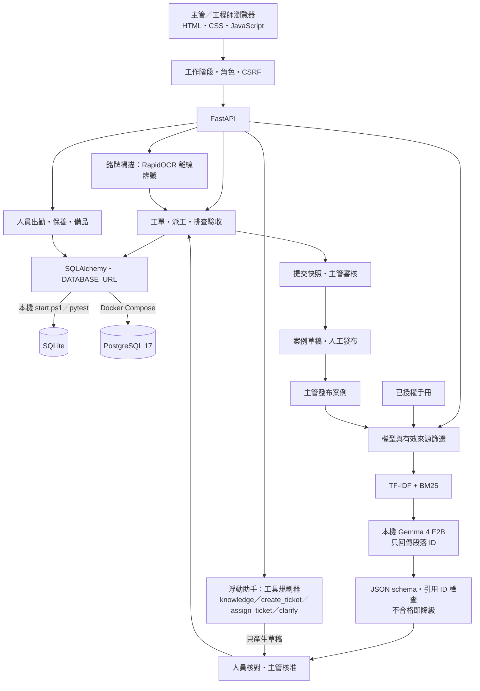

# PredictFix AI｜智慧工廠維修 Copilot

> CNC 換刀卡住了：該先查什麼、派誰處理、怎麼確認真的修好？PredictFix AI 把**有來源的手冊檢索、本機 LLM、資格派工與驗收流程**接在同一張工單上，讓每次維修的判斷依據都可追查。

**定位：可完整操作的本機 MVP。** 資料皆為虛構或合成；尚未接真實感測器與企業系統，也未完成工廠現場驗收與領域專家評估。

## 要解決的問題

- **誰**：CNC 工廠的維修主管與維修工程師。
- **痛點**：一次維修需要三種資訊——手冊裡的排查依據、人員的資格與可用時間、工單中的量測與復測結果。它們常散落在文件與口頭交接中，事後很難回答「為什麼這樣修」與「憑什麼結案」。
- **為什麼難**：
  - 維修建議若直接由 LLM 自由生成，可能捏造步驟或引用，現場不能接受。
  - 工單、手冊與人員資料不適合送到雲端，需要能在工廠內 CPU 跑的本機模型。
  - 派工與結案牽涉權限、並發與重送，不能只靠前端畫面把關。

## Demo

[](docs/media/predictfix-demo.mp4)

- **[▶ 60 秒完整操作影片（含中文旁白）](docs/media/predictfix-demo.mp4)**：本機展示模式實機錄影，涵蓋報修補問、核准清單、資格派工、驗收阻擋、主管審核與案例發布。
- **[公開互動展示](https://predictfix-mobile-demo.ruru0109lee.chatgpt.site)**：免登入，可用手機或電腦操作虛構維修流程。這是**靜態模擬介面**（原始檔在 `sites/predictfix-mobile/`），沒有連接 FastAPI、即時 LLM 或資料庫；完整系統需依[如何執行](#如何執行)在本機啟動。


*實際系統截圖；設備、工單與手冊均為虛構展示資料。另有[手機版畫面](docs/images/machine-scan-mobile.png)。*

展示情境「CNC-03 換刀卡住，只發生在特定刀位」：報修補問 → 比較候選手冊與案例原文 → 主管核准排查／驗收清單 → 依資格、出勤、容量派工 → 工程師逐項排查（驗收失敗時後端阻擋提交）→ 主管審核或退回重修 → 整理成案例，下次維修可再檢索。

## 架構



後端控制流程與資料修改，模型只提供受限的選段與規劃建議。本機 `start.ps1` 優先以 llama.cpp 執行 Gemma（另支援 Ollama）；`compose.yaml` 以 PostgreSQL 17＋Ollama 部署，`compose.production.yaml` 另含外部工單 worker 與 Caddy 反向代理。

| 路徑 | 責任 |
|---|---|
| `backend/maintenance_ai.py` | 手冊版本、檢索、段落引用、案例草稿與發布 |
| `backend/agent.py` | 浮動助手的受限工具規劃（只讀資料，操作需使用者確認） |
| `backend/repair_flow.py` | 報修補問、核准清單、逐項結果、保養與備品異動 |
| `backend/workforce.py` | 帳號、資格、出勤、工時、派工容量核對 |
| `backend/machine_scan.py`、`backend/nameplate.py` | 銘牌 OCR 與機台總覽 |
| `backend/knowledge_graph.py`、`backend/integrations.py` | 維修知識圖譜、外部工單 API／CSV／outbox |
| `tests/`、`scripts/` | 隔離測試、模型／檢索評估、安全報告、備份工具 |

## 技術重點

**1. 讓 LLM 只做「選擇」，由程式驗證。** 模型只能回傳候選段落的 ID，後端檢查欄位、型別、數量與 ID 是否存在，再從來源取出原文。捏造引用或格式不合格就降級為「規則產生」，不把自由生成文字當成維修步驟；來源存在仍需主管核對適用性。

**2. 本機模型選型有基準與合規考量。** 在 44 題段落選取基準上，Gemma 4 E2B 選對 100%，原本的 Qwen3-0.6B 只有 22.7%；加上台灣案場對中國開發模型的合規疑慮，於 2026-10-15 改用 Gemma 4 E2B Q8_0（Apache 2.0，llama.cpp 純 CPU）。台灣自製備案 Llama-Breeze2-3B 選對 88.6%（見 `docs/model-selection.md`、`artifacts/local-llm-benchmark.json`）。

**3. Agent 是「規劃器」而非「執行者」。** 浮動助手以 JSON schema 限定四種工具；建立工單、派工只產生 5 分鐘有效的操作草稿，需使用者確認後再走既有 API 與權限檢查。提示詞明確把工單與對話內容標為資料而非指令，且此助手只允許本機模型，不把工單與人員名單送到雲端（`backend/agent.py`）。

**4. 推薦與實際派工各檢查一次。** 介面上的推薦可能過期；派工 API 會再核對資格與剩餘容量，SQLite 與 PostgreSQL 的並發指派都有測試，避免兩次操作同時用掉容量。

**5. 結案是一段可回看的流程。** 附清單的工單必須完成排查與驗收才能提交；提交保存當時的來源與結果快照，退回重修會保留前次證據。重送與並發另以冪等請求與版本檢查處理（例如備品領用不重複扣帳）。

**6. 先用攻擊測試重現，再修正。** 安全測試先重現「草稿／撤回資料被工程師讀取」「已發布案例暴露原始快照」「驗證錯誤回傳密碼」等問題再修正；模型攻擊測試同時核對身分與案例狀態，不只看回答文字（`docs/security-testing.md`）。

**7. 微調實驗誠實記錄，未達標就不採用。** Gemma QLoRA（GTX 1050 Ti 4 GB、NF4）跑了兩輪：126 步版本全部輸出空選段；504 步版本在新 100 題合成題上完全正確率由 18% 升到 42%，但 recall 由 90.77% 降到 50.77%、三段答案 0/20，因此 `modelReady: false`，未替換現用模型（`artifacts/interview-20261021/selection-independent-v5-comparison-20261020.json`）。

## 成果與數字

| 項目 | 結果 | 來源 |
|---|---|---|
| 自動化測試 | **164 passed**（2026-10-30 本機重跑 `pytest tests`，Python 3.13，不需模型服務與 API key）；2026-10-21 完整回歸 161 項、零跳過 | `tests/`、`artifacts/interview-20261021/tests.xml` |
| AI／API 安全檢查 | 45／45 通過，含 8 個真實本機模型攻擊情境（2026-10-15，Gemma 4 E2B） | `artifacts/security-test-report.json` |
| 檢索方法比較 | 16 題正例 Top-3 命中 15 題（93.75%）；4 題負例皆無結果；TF-IDF／BM25／融合同分 | `artifacts/retrieval-eval-report.json` |
| 銘牌 OCR | 90 張合成銘牌（18 台 × 5 種變化）top-1 100%、自動開錯台 0 次 | `artifacts/ocr-eval-report.json` |
| 完整展示流程 | 驗收失敗阻擋、復測提交、主管審核、案例發布與再檢索通過 | `artifacts/interview-walkthrough-report.json` |
| CI | GitHub Actions 跑全套測試、正式／展示雙模式容器與 PostgreSQL 情境 | `.github/workflows/`、[執行紀錄](https://github.com/mina201199/predictfix-ai-factory/actions/runs/39509848713) |
| 公開軸承資料（CWRU）分類實驗 | 跨負載測試 Accuracy 66.7%、Macro-F1 0.556，內圈 Recall 0（泛化不足，獨立實驗） | `artifacts/model-report.json` |

檢索、OCR 與選段題集都是開發用合成資料，不是獨立保留集，也不代表真實工廠照片或 AI 回答的正確率；安全檢查是有限情境驗證，不是全面滲透測試。

## 如何執行

在 Windows 專案根目錄執行，原始開發環境為 Python 3.12：

```powershell
.\setup.ps1
.\start.ps1 -Demo -Port 8082            # 展示模式：虛構資料與角色快速體驗
.\start-production.ps1 -Port 8083       # 或正式資料模式：空資料庫與真實帳號登入
```

| 入口 | 用途 |
|---|---|
| <http://127.0.0.1:8082/workflow.html> | 報修、排查驗收、保養與備品 |
| <http://127.0.0.1:8082/knowledge.html> | 手冊、案例與維修 Copilot |
| <http://127.0.0.1:8082/scan.html> | 銘牌掃描與機台總覽 |
| <http://127.0.0.1:8082/docs> | Swagger API 文件（僅展示模式） |

準備展示工單：服務啟動後另開終端機執行 `.\.venv\Scripts\python.exe scripts\prepare_interview_demo.py`。本機 LLM 為額外安裝：`scripts\setup_local_llm.py`、`scripts\prepare_model.py`；沒有模型服務時，知識中心仍顯示候選來源，並標示未執行模型。

`.env.example` 列出可用設定；`OPENAI_*` 為選配，預設不傳送文件到雲端。首次建立正式帳號的 `BOOTSTRAP_PASSWORD` 請放在環境變數或未追蹤的 `.env`，不要寫進程式碼。

測試（建立隔離 SQLite，不寫入運行中的資料庫）：

```powershell
.\.venv\Scripts\python.exe -m pytest -q
.\.venv\Scripts\python.exe scripts\run_security_checks.py
.\.venv\Scripts\python.exe scripts\verify_postgres.py container   # 需 Docker；Compose 正式模式＋PostgreSQL
```

更多設定見 [本機安裝](docs/local-setup.md) 與 [正式環境與部署](docs/production-setup.md)。

## 已知限制與下一步

- **資料全為虛構或合成**：手冊、設備、工單、評估題集與標註都由同一作者建立，沒有外部維修專家盲測。
- **尚未上線**：正式後端沒有外部可用網址；公開展示是靜態模擬介面。Docker／PostgreSQL 有驗證紀錄，手機與企業 HTTPS 環境仍待驗收。
- **AI 範圍有限**：補問是結構化欄位檢查，比較的是候選來源，尚未自動產生完整維修方案；知識圖譜尚未接入一般 AI 查詢。
- **微調未採用**：Gemma QLoRA 504 步結果與訓練程式位於另外的實驗分支，未合併、未替換現用 Q8_0 模型。
- **未實作**：PLC／感測器接入、健康度與剩餘壽命預測、完整 PDF 手冊匯入／OCR、企業 SSO、多租戶、真實 ERP／人事串接。
- **下一步**：建立獨立手冊題集與相關性標註、由領域人員評估引用適用性；完成公開後端部署（HTTPS、監控、異地備份演練）。

## 我負責的部分

本專案由我（[mina201199](https://github.com/mina201199)）獨立完成，從需求定義、系統設計、後端與前端實作、本機 LLM 選型與微調實驗、評估與安全測試、部署到文件，皆由我負責。

## 延伸文件

[操作手冊](docs/repair-flow.md) · [系統架構](docs/system-architecture.md) · [安全測試](docs/security-testing.md) · [權限設計與矩陣](docs/access-control.md) · [模型選型與合規](docs/model-selection.md) · [本機 LLM 基準](docs/local-llm-benchmark.md) · [Gemma SFT 實驗](docs/gemma-sft-protocol.md) · [維修知識圖譜](docs/knowledge-graph.md) · [外部工單介接](docs/ticket-integration.md)

<details>
<summary>歷史實驗：Qwen3-0.6B CPU LoRA 與本機部署紀錄（由 <code>scripts/update_experiment_readme.py</code> 產生）</summary>

<!-- experiment-results:start -->
**歷史本機部署紀錄：deployed。** 當時在 `http://127.0.0.1:8084` 驗證正式資料模式，採獨立資料庫與具有檔案雜湊的版本快照；不代表該服務現在仍開啟。

已驗證登入與主管權限、匿名阻擋、關閉快速登入、重啟後帳號保存，以及 SQLite 備份／新庫還原與工作階段撤銷。尚未部署公網；Docker 映像已由 CI 以正式模式實際啟動驗證，PostgreSQL 已有重啟保存與 `pg_dump` 還原紀錄。本機 TLS 與正式環境仍未驗收。

**LoRA 任務：根據報修問題與候選原文，選取相關段落 ID；無依據時輸出空清單。** 資料為 44 題原創虛構案例，按來源主題分組，訓練／驗證／測試為 24／8／12 題。

實驗狀態：`completed`；模型：`Qwen/Qwen3-0.6B`；run：`cpu-smoke-v1`。

| 同一組 12 題來源主題保留測試 | 原模型 | LoRA 模型 |
|---|---:|---:|
| 段落集合完全符合 | 0.0% | 75.0% |
| 選取 Precision | 0.0% | 100.0% |
| 選取 Recall | 0.0% | 100.0% |
| 合法輸出 | 0.0% | 75.0% |
| 資料不足判斷 | 0.0% | 0.0% |
| 文件注入題正確選取 | 0.0% | 100.0% |
| 平均生成耗時（CPU） | 9.45 秒 | 5.53 秒 |

CPU float32、LoRA rank 4、q_proj/v_proj、batch 1，共 12 步；僅訓練 573,440 個參數。訓練耗時 187.4 秒。

Exact match 變化：**+75.0 個百分點**。這是小規模流程實驗，不能證明現場維修成效；訓練 loss、逐題原始輸出、版本與雜湊均保存。

本實驗使用 Transformers、無 JSON grammar，嚴格拒絕 Markdown 包住的 JSON；現有 llama.cpp 服務有格式約束，這些數字不等於線上服務正確率。生成耗時也受回答長度影響。

**目前保留原服務模型，未自動替換。** 此 adapter 尚未完成量化部署、安全回歸與專家評估。

**失敗分析：3 題資料不足題未正確拒答。** 例如輸出 `{"selected":[""]}`，包含不存在的段落 ID；仍須由後端拒絕與降級。此結果尚不符合替換現有模型的條件。

**歷史 Qwen adapter 曾在 `http://127.0.0.1:8085` 驗證推論。** 當時重新載入保存權重，驗證同題輸出一致與錯誤輸入拒絕；不代表服務現在仍開啟，也不是最新 Gemma QLoRA 的部署證據。這是獨立實驗 API，尚未接入正式維修流程。詳見 [推論部署報告](artifacts/lora-serving-report.json)。

[實驗方法與重跑](docs/lora-training.md) · [部署報告](artifacts/local-deployment-report.json) · [LoRA 完整報告](artifacts/lora-training-report.json) · [資料集](training/selection-dataset.json)
<!-- experiment-results:end -->

</details>

## 授權

程式碼與文件以 [MIT License](LICENSE) 授權。CWRU 軸承資料、模型權重等第三方資源依其各自授權使用。
