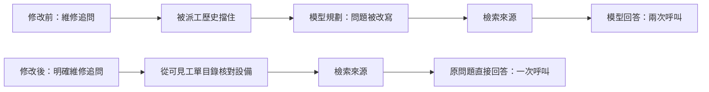

# 自由追問改善實測 — 2026-10-22

問題：`那現場要記錄哪些資訊？`

使用同一份示範資料庫快照、相同六則建立工單／派工對話、本機 Gemma 4 E2B Q8_0、同一 CPU 服務，修改前後各連續測試三次。測速期間沒有同時執行測試套件。模型未替換，也沒有將標準答案寫死在程式內。

## 原因

1. 前文含工單或派工就退出快速問答，額外呼叫 Decision 規劃器。三次分別耗時 15.88、4.50、4.53 秒。
2. 規劃器把最新的「記錄哪些資訊」改成「特定刀位換刀卡住應查閱哪些維修資料？」或「特定刀位換刀卡住應核對哪些資料」，造成回答偏離問題。
3. 回答提示原本限制每點 15～25 字並要求不抄原文，容易壓掉並列項目。來源完整包含刀位、警報、近期變更；三次檢索都取到這段，問題不是手冊缺資料。
4. 延伸測試「那現場需要記錄什麼？」另重現引用誤擋：模型完整回答，但正文包含「來源S1」，既有數字檢查將 `1` 視為新增數值。已修正為只略過經核對的明確引用標籤，其餘維修數值仍檢查。失敗輸出保留於 `sequence.json`。

## 修改

- `backend/agent.py`：明確維修追問可直接查來源，最新問題原文送入 Answer。歷史工單編號只能從目前可見的資料庫目錄解析設備；未知編號、更正與設備歧義不任選舊設備。操作指令、簡短補充及草稿確認問題仍走規劃器。
- `backend/agent_answers.py`：一點可回答就只寫一點，要求完整保留相關項目與條件，允許沿用來源文字；維持每點 90 字、最多兩點及原有引用／數字檢查。
- `tests/test_agent_followup.py`：驗證派工後追問只呼叫一次模型；保留操作、未知設備與工單、不同設備歧義、草稿追問的處理。
- 引用回歸：允許與引用欄位相同且有效的「來源S1」或 `[S1]`，仍拒絕新增 `1毫米`、`S10`、`XS1` 或裸寫 `S1部件` 等不屬於明確引用的數字。



## 同題結果

| 指標 | 修改前 | 修改後 |
|---|---:|---:|
| 首段內容，三次秒數 | 22.11 / 10.88 / 8.48 | 7.40 / 4.28 / 4.75 |
| 首段內容，中位數 | 10.88 秒 | 4.75 秒 |
| 完整回答，三次秒數 | 26.99 / 15.35 / 13.14 | 9.84 / 7.35 / 7.54 |
| 完整回答，中位數 | 15.35 秒 | 7.54 秒（減少約 51%） |
| 每次模型呼叫數 | 2 | 1 |
| 正文涵蓋刀位、警報、近期變更 | 1 / 3 次 | 3 / 3 次 |

修改前第 2 次：

> 1. 檢查當下的刀位設定是否正確無誤。 [S1]
> 2. 確認刀具主檔和刀位資料是否一致。 [S1]

修改後第 2 次：

> 1. 記錄時應包含刀位、警報資訊以及近期變更的內容。 [S1]

三次來源均為 `MAN-2279398c3c201f690f96562492450e1b:2`，來源 SHA256：`1f8a887ef5a783ede00793feba010892cfcf1c266a5408780e8757d3177cbd0c`。

三次是小樣本，本機服務保留正常快取，首輪與後續輪速度不同，不能視為所有問題的效能保證。完整性以本題來源要求的三項記錄人工核對；引用檢查不等於全面語意驗證。

第一版較長提示曾產生多餘的寫作說明，已再次精簡；中間結果保留在 `after.json`、`after-final.json`，表格使用包括引用修正的最終 `after-verified.json`，沒有挑選單次最快結果。

## 證據與重跑

本機證據目錄：`.runtime/followup-20261022/`（忽略於 Git）：

- `before.json`、`after-verified.json`：相同 request、每次時間、模型階段、提示與完整回答。
- `before-agent.py`、`before-agent_answers.py`：修改前原始碼備份。
- `fixture.db`：唯讀用途的示範資料快照。
- `probe.py`：直接執行正式 `streamChat` 流程，實際連線本機模型，並測量第一個可顯示段落及最終結果。

在專案根目錄執行（需模型服務仍在 18964，結果名稱不可與既有檔案重複）：

```powershell
$env:PYTHONUTF8='1'
& '..\predictfix-ai-factory\.venv\Scripts\python.exe' .runtime/followup-20261022/probe.py repeat-new
```

網頁驗證：開啟 `http://127.0.0.1:18962/knowledge.html` 的維修 Agent，先問 `PF-INTERVIEW-DEMO 新增刀具後，只有特定刀位卡住，先核對什麼？`，再問 `那現場要記錄哪些資訊？`。應看到適用機型、三項記錄與 `[S1]` 引用；本頁使用虛構示範資料。

## 自動化測試

路由與提示修正後，全套 `pytest tests`：162 passed，1 則既有 StarletteDeprecationWarning，232.93 秒。最後補上引用誤擋修正後，重跑問答、串流、操作規劃、本機模型請求與新增回歸測試：6 passed，15.69 秒。結果分別保存於 `tests.xml`、`final-targeted.xml`。兩個新增問題均先建立失敗測試，再修正確認通過。

重啟網站後，實際 `/api/agent/chat` 的同六則歷史與三題驗收全部通過（`live-endpoint.json`）：原題完整回答 8.64 秒；「那現場需要記錄什麼？」完整回答 11.08 秒，正文的來源 S1 不再誤擋；「那刀具資料要核對哪些欄位？」0.02 秒回報來源未明列欄位，沒有編造清單。這組網站驗收不混入前述三次基準的中位數。

瀏覽器重新登入後，依上方兩題流程實際操作，追問顯示「應記錄刀位、警報以及近期變更的資訊。[S1]」，畫面計時首段 8.1 秒、完整 8.8 秒。截圖：`.runtime/followup-20261022/final-browser.png`。這次網頁確認使用兩題的新對話；效能表使用固定六則歷史，兩者不混算。
