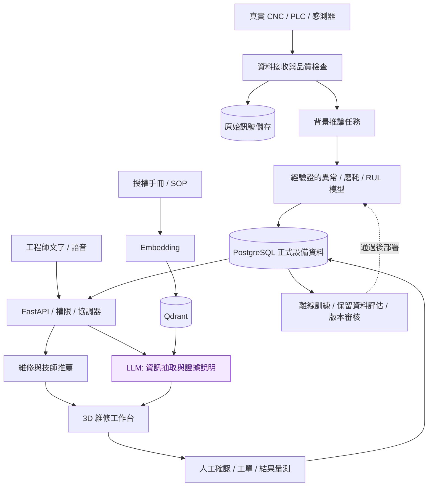

# 系統架構與邊界

> 本頁保留早期設計記錄，部分狀態已過時。最新實作、架構圖與限制請見 [目前系統架構](system-architecture.md)。

## 實際運作

瀏覽器只透過同來源 FastAPI API 呼叫功能。工單與稽核以 SQLAlchemy 寫入 SQLite，容器設定可切換 PostgreSQL。`/api/predict` 對公開實驗視窗抽取特徵、執行已訓練模型，再保存可追溯結果。

本機 LLM 用獨立 CPU 服務提供推論，後端送入使用者文字與檢索片段。LLM 原始欄位与規則結果均可查看；設備識別的應用程式主欄位由規則檢查，避免將生成內容直接用於派工。

## 計畫擴充（未實作）

## API

| 路徑 | 功能 |
|---|---|
| GET /api/health | 真實服務與模型狀態 |
| GET /api/model/report | 資料切分、來源與模型評估 |
| GET /api/replay | 供 UI 選擇的測試資料 |
| POST /api/predict | 真實軸承分類，保存稽核 |
| GET /api/tickets | 資料庫工單 |
| POST /api/tickets | 建立工單，支援 Idempotency-Key |
| POST /api/tickets/{id}/complete | 填修復結果並結案 |
| GET /api/engineers | 根據零件、專長與工單負荷排序 |
| GET /api/documents | 本機展示文件檢索 |
| POST /api/copilot | 本機 LLM／明確的規則降級 |
| GET /api/audit | 最近 30 筆操作與推論證據 |

本機 MVP 未有登入、權限、資料遷移、稽核保留策略或工廠安全控制。模型只能提供實驗結果，不會自動停機或自動確認復機。
