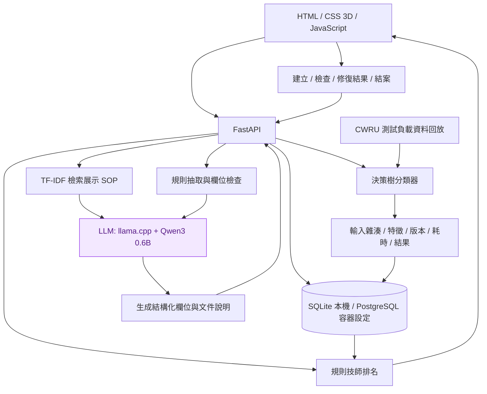
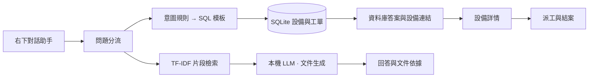

# 開發紀錄（歷史版本）

> 本文件保存截至 2026-10-06 的原始開發說明。內容依功能加入時間累積，可能包含過時狀態；最新功能以 [專案首頁](../README.md)、[維修流程手冊](repair-flow.md) 與 [正式環境手冊](production-setup.md) 為準。
>
> 文中的本機模型 Qwen3-0.6B 已於 2026-10-15 淘汰，現用 Gemma 4 E2B Q8_0。淘汰原因：44 題基準只選對 22.7%，以及台灣案場對中國開發模型的合規疑慮。詳見 [模型選型與合規](model-selection.md)。

# PredictFix AI

## 排查清單、保養與備品（2026-10-06）

新增 `/workflow.html`：報修條件補問與來源比較、主管核准排查／驗收清單、資格與容量派工、工程師逐項結果、復測審核及案例累積。清單驗收未通過不能提交；退回重修保留上次快照並要求重新確認。另提供定期保養到期提醒與冪等建立工單、備品入庫／工單領用／退料及低庫存提示。詳細規則與限制見 [維修流程、保養與備品](docs/repair-flow.md)。

## 正式資料環境（2026-10-06）

現在預設使用獨立的正式資料環境，從空資料庫開始，不自動建立展示設備、人員、案例或手冊。`./start-production.ps1 -Port 8083` 啟動，開啟 <http://127.0.0.1:8083/>；初始管理員憑證保存在未納入 Git 的 `data/production-access.json`。帳號 `supervisor`，首次登入請修改密碼。

新增真實設備建檔、帳號建立／停用／密碼重設、技能與資格、帶日期班次、到班／請假紀錄、工單剩餘估時、實際維修工時，以及出勤與容量派工。完整流程是通報 → 估時與資格 → 推薦與主管派工 → 工程師維修與證據 → 主管審核 → 案例發布 → AI 引用。正式版的 `/` 使用 `console.html`，AI 中心沿用 `/knowledge.html`。展示回放、旧聊天與硬編碼設備介面在正式模式關閉。

詳見 [正式環境啟動、備份還原與部署手冊](docs/production-setup.md)。目前本機正式服務可運作；尚未接企業實機資料、完成現場验收或部署公開伺服器。`compose.production.yaml` 已提供 PostgreSQL + HTTPS 部署設定，但此次 Docker daemon 不可用，容器與 PostgreSQL 路徑尚未實測。不要把部署設定或自動化測試當成企業上線驗收。

`APP_MODE=production` 是預設，`APP_MODE=demo` 才載入示範資料；快速登入還需要 `DEMO_MODE=1`。`start.ps1 -Demo` 明確開啟展示模式，與正式版数据库分開。下列舊版展示、感測器與履歷說明僅適用 demo 模式。

## 維修 AI 中心（2026-10-06）

新增 [完整架構圖](docs/system-architecture.md) 與 `/knowledge.html`。主管可匯入 TXT／Markdown 手冊，保存機型、版本、來源與示例標記；撤回文件不再進入新助手檢索。PDF／OCR 尚未支援。

已完成工單可建立維修案例草稿，保存原工單、量測、照片與審核快照。主管補齊機型、症狀、条件、發現、原因狀態、處置與驗收後發布；只有已發布案例進入新助手檢索。修改需先撤回，保留歷程及修訂版本。AI 可將原維修結果分類為欄位建議，通過原文檢查後由人員自行保存，不補寫未做的措施。

新助手使用 TF-IDF＋BM25 排名融合，依機型與是否允許合成資料篩選。LLM 選取來源段落 ID，程式映射回原文並顯示引用；不能把這種檢查等同診斷驗證。無有效模型結果時顯示候選來源，資料不足時明確說明。舊有右下對話的唯讀 SQL 查詢仍保留。

本機展示：`./start.ps1 -Demo -Port 8082`，開啟 `http://127.0.0.1:8082/knowledge.html`。可執行 `python scripts/seed_knowledge_demo.py` 建立三筆合成工單與已發布案例；只允許 localhost 且必須開啟 DEMO，重跑不重複建立相同事件。這些資料會保存到本機資料庫並出現在工單統計，不能當真實維修成效。

驗證命令：`python -m pytest -q`、`python scripts/evaluate_retrieval.py`、`python scripts/verify_knowledge_live.py`。20 題合成開發題比較結果保存於 `artifacts/retrieval-eval-report.json`；三種方法的 Top-3 文件命中率皆為 0.9375，混合方法未展現優勢，不宣稱提升。三題實際本機模型呼叫成功選取來源原文，報告為 `artifacts/knowledge-live-smoke.json`，只證明串接與引用存在，非回答品質驗收。

目前 28 項測試通過，前端語法檢查通過。已以瀏覽器核對主管登入、手冊與案例列表、發布內容與來源快照。新的 AI 中心已接上既有工單流程，既有右下對話尚未切換至新助手；以側欄「維修 AI 中心」進入。

## 完整示範維修手冊（2026-10-05）

新增 [四份完整虛構手冊](docs/manuals/README.md)：主軸與潤滑、自動換刀、冷卻循環、進給與定位。每份含 12 個章節，包含適用範圍、巡檢、症狀矩陣、排查分支、備品、驗收、合成案例及交接表。它們是原創示範資料，非任何廠商原廠手冊；PF-VMC850-DEMO、PF-Control-D、料號與警報均為虛構，案例讀值不是安全門檻。現有 CNC 設備沒有自動被認定為該機型。

後端從 `docs/manuals/manifest.json` 載入，依章節檢索並保留文件版本、來源路徑、行號與虛構標記。共 30 份文件、78 個檢索片段（原有 26 份／30 段，加 4 份／48 章）；檢索仍為 TF-IDF，未聲稱已完成語意檢索或引用正確性驗證。重新啟動服務後載入新資料。

Git 版本控制排除本機資料庫、初始帳號、環境變數、模型執行環境及下載的軸承原始資料。私人儲存庫亦不應保存登入密碼或工作階段資料。

本版驗證：24 項測試通過，包括手冊結構、來源行號、四類問題檢索及路徑限制；前端 JavaScript 語法檢查通過。這些檢查不等於本機 LLM 回答品質驗收，Docker 容器執行仍未驗證。

CNC 設備維修 MVP：3D 設備與零件示意、公開軸承資料模型推論、本機 LLM 維修知識助手、可解釋的技師推薦，以及後端保存的維修工單。

此專案是面試作品與本機展示系統。沒有連接真實 CNC，沒有驗證可投入工廠的健康度或剩餘壽命模型。

## 完成狀態

| 功能 | 實際狀態 |
|---|---|
| 3D 機器、零件定位、旋轉與健康介面 | 已完成；CSS 3D 概念模型，非精準 CAD；健康、壽命與廠區指標為模擬 |
| 軸承模型 | 已訓練決策樹；CWRU 12k DE 0.007 吋人工故障；三類已知故障分類 |
| 推論證據 | 前端可回放、顯示分類分數與輸入雜湊；資料庫保存請求、特徵、版本、輸出與耗時 |
| 工單 | FastAPI＋SQLAlchemy；本機 SQLite；建立、冪等提交、修復結果及結案 |
| 技師推薦 | 後端規則評分；履歷是模擬，工作負荷讀取實際未結案工單；非學習式推薦模型 |
| 本機 LLM | 支援 llama.cpp＋Qwen3 0.6B；也支援 Ollama；回傳模型與執行證據，失敗明確降級 |
| 維修知識檢索 | TF-IDF 字元 n-gram＋LLM；4 份自製展示文件，非原廠手冊；未使用 Embedding／Qdrant |
| Docker／PostgreSQL | 已提供設定；本機 Docker 引擎尚未就緒，容器執行未驗證 |
| 雲端模型 API、權限、真實 PLC、健康／RUL 模型 | 尚未實作 |

## 快速啟動（Windows）

需要 Python 3.12。第一次建立環境：

```powershell
python -m venv .venv
.\.venv\Scripts\python.exe -m pip install -r requirements.txt
.\.venv\Scripts\python.exe scripts\prepare_model.py
.\.venv\Scripts\python.exe scripts\setup_local_llm.py
```

本機模型下載自官方 Qwen GGUF 與 llama.cpp 發行版，放在 `.runtime/`。Qwen 模型約 640 MB，CPU 工具約 20 MB；執行使用 CPU。之後啟動：

```powershell
.\start.ps1
```

- 工作台：<http://127.0.0.1:8080>
- API 文件：<http://127.0.0.1:8080/docs>
- 服務狀態：<http://127.0.0.1:8080/api/health>
- 推論與工單稽核：<http://127.0.0.1:8080/api/audit>

`start.ps1` 會在模型檔存在時啟動本機服務；第一次載入模型需等待。若模型服務不可用，Copilot 明確顯示規則處理，不會偽稱 LLM 已執行。所有服務僅綁定本機；沒有登入或權限管理，不適合直接公開部署。

舊 `node server.cjs` 只服務靜態 demo，不提供新版 API；正式 MVP 請用 `start.ps1`。

## 五分鐘 Demo

1. 維修工作台的「真實模型推論」選擇回放檔案，按執行推論；觀察資料標籤與預測是否相符。
2. 開啟評估報告，說明驗證與測試負載的差異、模型泛化限制。
3. 設備總覽選 CNC-03，旋轉 3D 示意、選主軸軸承。這裡健康度與壽命仍是模擬，不來自分類模型。
4. 輸入「CNC03 主軸震動，溫度92度，E102」。查看本機 LLM 執行標示、結構化資訊與檢索文件。
5. 查看技師推薦原因，建立工單；重新整理確認保存；再填修復結果結案，觀察工作負荷與排名更新。

## 實作架構



LLM 嘗試抽取欄位與根據文件生成說明。設備識別與溫度採用可驗證的規則結果作為應用程式主欄位，模型原始欄位另外顯示，用於比較及檢查。生成說明仍可能有錯誤；目前不是經完整評估的維修診斷模型。

完整規劃与未來服務見 [架構設計](docs/architecture.md)。

## 模型資料與評估

資料下載自 [CWRU 官方 12k 驅動端軸承資料](https://engineering.case.edu/bearingdatacenter/12k-drive-end-bearing-fault-data)。使用 0.007 吋內圈、滾珠、外圈 6 點方向故障，共 12 個檔案。非健康樣本、非實際 CNC 工廠量測。

- 每個視窗 2,048 點、12 kHz、非重疊，每個檔案取前 56 個視窗。
- 特徵：RMS、標準差、峰值、峰對峰值、波峰因數、峰度、偏度、頻譜重心與六段頻譜能量。
- 訓練負載：0、1 HP（336 視窗）；驗證：2 HP（168）；測試：3 HP（168）。
- 測試檔案沒有用來 fit。不同負載可能共用同一人工故障軸承，故這不是未見軸承測試。
- 測試只有 3 個独立檔案；視窗不是 168 個独立實驗。

| 成績 | Macro-F1 | Accuracy |
|---|---:|---:|
| 驗證負載 | 0.9454 | 見完整報告 |
| 測試負載 | 0.5556 | 0.6667 |
| 多數類別基準（測試） | 0.1667 | 0.3333 |

測試負載下內圈全部被錯判為外圈。模型不具備可靠現場診斷能力；此結果展示負載泛化問題，不能僅呈現驗證高分。分類分數不是校準故障機率，亦不能換成健康百分比、未來七天風險、嚴重度或剩餘壽命。

可重現訓練與完整資料來源／SHA256：[prepare_model.py](scripts/prepare_model.py)、[模型報告](artifacts/model-report.json)。

## LLM 與文件限制

- 本機模型：Qwen/Qwen3-0.6B-GGUF，Q8_0；來源與工具版本保存於 `.runtime/local-llm.json`。
- 文本先做 TF-IDF 檢索，再把文件片段送給本機 LLM；這是檢索輔助生成，未用向量資料庫。
- E102 是專案示例錯誤碼，不宣稱所有 CNC 的 E102 都代表過熱。
- 文件為自製示例，應替換成有授權的機型手冊後再評估。
- 工單資料留在本機資料庫；LLM 目前只接收輸入文字與展示文件。
- 未來更換模型供應商可改 `backend/copilot.py` 的服務呼叫；目前沒有呼叫 OpenAI API。

## 驗證

```powershell
.\.venv\Scripts\python.exe -m pytest tests -q
.\.venv\Scripts\python.exe scripts\verify_llm.py
```

測試覆蓋工單保存、冪等提交、結案驗證、無效輸入、工作負荷影響排名、沒有 LLM 時的誠實降級、真實模型推論與稽核，以及靜態檔案存取限制。

LLM smoke test 僅檢查 3 個例子的服務與欄位，不能當成獨立測試集的品質成績；報告保存於 `artifacts/llm-smoke-report.json`。

本機驗證：6 項 API 測試通過，3 次 LLM 呼叫皆產生可解析結果且機台欄位符合預期，耗時約 2.4–4.4 秒。人工檢查發現第一例漏抽 E102，回答只重述問題；第二例加入輸入未陳述的症狀，且回答未附文件編號。因此這只是串接通過，尚未達到回答品質驗收。前端保留規則欄位、模型欄位與檢索片段供比對，檢索片段不代表模型已正確引用。

## Docker（容器執行尚未驗證）

先產生 `artifacts/` 模型，再於 Docker Engine 就緒後執行：

```powershell
docker compose up --build -d
docker compose exec ollama ollama pull qwen3:0.6b
```

> 已淘汰：`qwen3:0.6b` 是 2026-10-06 當時的模型，請勿再執行；現行 Compose 設定使用 `gemma4:e2b-it-q8_0`。

容器配置使用 Ollama 替代 Windows llama.cpp；PostgreSQL 不對外開放。固定示例密碼僅供本機開發。容器版的 LLM 推論與資料保存需另行驗證。

## 設計取捨與下一步

設備總覽為預設首頁，資料庫初始化提供 CNC-01～18 共 18 台展示機器，可搜尋、依機型／警示篩選，以及警示／使用率／編號排序。卡片可獨立旋轉與選取零件。新增機台保存於資料庫，健康度未知；刪除採可復原停用，保留歷史工單，未結案任務會阻止停用。

維修工作台處理單一設備的線索、文件、技師配對與工單，隱藏整廠重複總覽。模型實驗移到可展開區。維修人員頁提供 8 位示例人員的專長、班別、示例任務與資料庫正式任務，工單頁可重新指派人員。履歷、班別和建議容量不是實際人事資料。

維修分析彙整全部資料庫工單，呈現未派工、未結案、報修次數、人員負荷及建立至結案耗時；另列 DEMO 零件優先巡檢。建立至結案不是實際修復工時，報修次數不是故障率，不提供未經資料驗證的 MTTR／MTBF 或節省金額。

知識庫共 26 份專案自製示例（4 份檢查文件＋14 個 FAQ＋8 份完整流程），可檢索與分類篩選。[完整內容](docs/knowledge-demo.md)。機型共用簡化幾何，不是原廠 CAD；設備與零件狀態為模擬。新增、刪除／復原、任務阻擋、派工與知識庫新增的整合測試通過；目前共 8 項測試。

1. 先保留簡單可重現分類器，解決跨負載泛化並加入正常類別；再研究完整退化資料的健康指標／RUL。
2. 建立未見刀具／軸承的獨立評估，避免同一實驗的相鄰視窗洩漏。
3. 為 LLM 增加完整標註測試集、引用驗證與錯誤分析；小型模型不保證專業回答品質。
4. 換入有授權原廠手冊，視資料量導入 Embedding／Qdrant。
5. 增加設備、零件、工程師、感測與維修案例正式資料表、權限與資料遷移。
6. 收集真實維修與派工結果後，才評估學習式推薦；目前規則可解釋且不需要假裝是 AI。

## 目前介面與對話查詢

選單為設備總覽、維修工單、維修人員、知識庫、維修成效。獨立工作台入口已移除，設備和任務共用設備詳情；模型回放保留於詳情的實驗區。設備總覽使用環形數量圖與零件健康條，人員頁只顯示資料庫任務卡片，不列虛構示例任務。

右下角維修助手支援收合與多輪對話。`POST /api/chat` 分流：設備／工單問題使用意圖規則編譯為唯讀參數化 SQL，結果可展開 SQL 與參數；文件問題使用 TF-IDF 檢索片段與本機 LLM。這是自然語言到 SQL 模板的原型，**不是 LLM 自由生成 SQL**；也不是任意問題都能回答。SQLite JSON 查詢模板尚未適配 PostgreSQL。對话不執行新增、修改或刪除操作。

可問：現在有哪些機台要檢查、CNC-14 有哪些未結案工單、Amy Chen 的任務、誰的任務負荷最多、某機台健康、換刀驗收、交班紀錄、冷卻排查。`它的工單` 可接續上一個機台問題。LLM 回答過短或僅回文件編號時，顯示檢索文件摘錄並標明降級方式；此判斷不能保證其他長回答正確。

知識庫目前 26 份文件、30 個檢索片段，內容分成約 300 字且重疊的片段後檢索。新增 8 份完整流程，保留原來 18 份示例與 FAQ。[完整文件](docs/knowledge-demo.md)。維修成效只分析历史報修集中度、結案比例、結案耗時和重複報修查核，不再重複現場警示／派工清單。已有 10 項整合測試。



## 工單審核、履歷與意圖模型

工單流程：待指派 → 已指派 → 維修中 → 待主管審核 → 已完成；主管可退回重修。提交結果不會直接結案。首次派工可由操作人員執行，已指派工單只有主管示範模式能重新派工且必須填原因；待審核與已結案不可重新指派。重新派工留存 audit，提交與主管審核保存 ticket_workflow。舊已完成工單保留為既有結案，不虛構主管審核。角色為本機 DEMO 的 header／UI 模式，不是已實作的登入驗證或正式 RBAC。

意圖分類模型由 `scripts/train_intent.py` 以 CPU 訓練，使用 TF-IDF 中文字元 1–3 grams＋LogisticRegression。8 類：零任務人員、工作負荷、待主管審核、未派工、未結案工單、设备警示、維修歷史、文件問答。80 句人工情境訓練／24 句人工改寫測試；Accuracy 0.8333、Macro-F1 0.8342。不是外部獨立評估，沒有微調 Qwen；分類結果結合明確意圖規則與唯讀 SQL 模板。資料集、模型與逐題報告在 artifacts/intent-dataset.json、intent-model.joblib、intent-report.json。

「誰沒有工單」使用人員名冊 LEFT JOIN 未結案工單，包含零筆人員；不再返回全部工單。「沒有工單」在此定義為沒有未結案工單，不代表當班可用。待主管審核仍算未結案。對話 Enter 送出、Shift+Enter 換行、輸入法組字時 Enter 不送出。

設備履歷可填啟用日、設備負責人、各零件安裝／更換日、下次檢核；新增檢核日期、人員、結果保存成歷程。年限由日期計算，未填不創造日期。機台年限与零件年限不能直接轉成健康度。日期與結果保存於 machines.payload.asset，目前没有自動排程或通知。知識庫已從一般選單移除，文件保留於後端供助手檢索。此版共 12 項後端測試。


## 帳號登入與設備履歷（2026-10-05）

啟動後會建立 1 位主管與 8 位工程師帳號，帳號、角色、密碼雜湊保存在 SQLite 的 `users`。每個初始帳號使用不同的隨機密碼，首次產生的登入資訊僅放在本機 `data/initial-accounts.json`（已加入 .gitignore；登入資訊屬於機密檔案，保管後可移除）。主管帳號為 `supervisor`；工程師帳號為 `amy`、`alex`、`bob`、`grace`、`david`、`ivy`、`eric`、`nina`。一般啟動不會重設帳號或密碼。`BOOTSTRAP_PASSWORD` 僅供隔離測試或受控首次佈署指定密碼，正常本機啟動不需設定。

- 主管：派工、重新派工、審核通過／退回、機台新增／停用／復原、編輯設備履歷與記錄檢核。
- 工程師：閱讀設備、人員與工單；報修或建立自己的工單；僅能開始及提交指派給自己的任務。
- 所有 `/api/*` 資料端點皆須登入（登入本身除外）；權限由後端帳號決定，偽造 `X-Demo-Role` 無效。審核及檢核人員取自登入身分，忽略表單冒用姓名。
- 密碼使用 PBKDF2-SHA256、隨機 salt、310,000 次迭代；工作階段採隨機 HttpOnly / SameSite=Strict Cookie，資料庫僅保存工作階段 token 雜湊，8 小時到期。登出立即撤銷；修改請求驗證 CSRF token 與來源，失敗登入限流。
- 本機 HTTP 開發使用非 Secure Cookie；HTTPS 佈署設定 `COOKIE_SECURE=1`。目前是自建帳號登入，尚未串企業 SSO、MFA 或密碼重設服務。

首次也會補齊目前已存在機台的空白履歷；往後手動新增的機台保持待建檔。18 台種子設備有啟用日期、4 個零件安裝／更換日期、設備負責人、下次檢核日與每台 3 筆 DEMO 巡檢記錄。全部寫入 `machines.payload.asset`，重新啟動保留已填資料；種子補齊缺少欄位，不覆蓋人工修改。日期初次建立以當日往前推算，畫面明確標示 DEMO 履歷。新手動新增機台不繼承其他設備履歷，健康度仍為未知。

驗證：`python -m pytest -q`，15 項通過，包括未登入拒絕、角色偽造拒絕、他人工單操作拒絕、CSRF、登出失效、工單提交及主管審核、種子履歷重跑不覆蓋。


## 維修證據與面試 DEMO（2026-10-05）

工程師在「維修工單 → 提交結果」可以填寫維修前後的溫度、振動、電流、壓力、轉速與定位偏差，包含單位及復測條件；也可匯入 UTF-8 CSV（`demo-measurements.csv` 範本）。CSV 每次最多 6 筆、64 KB；值在確認提交後保存於工單工作流程，原始 CSV 不另外保存。

JPG / PNG / WebP 照片每張上限 6 MB、2,000 萬画素，每次提交最多 6 張，每張工單累計上限 30 張。後端使用 Pillow 解碼驗證，照片原始二進位、SHA-256、上傳者與時間保存至 SQLite `ticket_evidence`；未經登入無法讀取。工程師只能上傳自己的已指派／維修中／退回重修工單。未提交照片只有上傳者與主管可看；提交後依現有工單讀取權限可查看。

主管審核可直接查看量測前後值、照片與維修文字。工單上的「量測與照片」可以回顧每次提交；退回重修不覆蓋以前數值。照片雜湊用於比對檔案內容，不保證拍攝現場真實性，這不是不可竄改的法律存證系統。

目前是多種資料形式的證據收集，`image_ai_used=false`。現有 Qwen3-0.6B 是文字模型，照片尚未傳給視覺模型，不能宣稱已完成多模態 AI 推論。後續可以接 VLM 比對照片與填寫數值，但審核仍由主管負責。

面試時執行 `./start.ps1 -Demo`，登入畫面會出現「以主管身分體驗」及「以工程師身分體驗」，不需填密碼；正常 `./start.ps1` 明確關閉快速登入。直接用 uvicorn 時，必須明確設定 `DEMO_MODE=1` 才會開啟。展示仍使用後端角色權限，工程師不能審核或管理機台。此模式使用目前資料庫，只應搭配 DEMO 資料，不應在含正式資料的服務開啟。DEMO 工作階段 1 小時到期。

驗證：18 項測試通過，涵蓋照片格式／容量驗證、他人照片與工單越權拒絕、CSV 驗證、數值與照片保存、退回後提交歷程保留、主管身分防冒用、DEMO 預設關閉及角色權限。瀏覽器亦完成 CSV 匯入、照片上傳與工單提交。


## 對話拒答與班別查詢

意圖分類器是封閉類別模型，分數高不代表問題一定屬於支援情境。資料庫路由現在要求語意關鍵詞與查詢主題同時符合；模型分類只作為候選，不足時不執行 SQL。早／中／晚班查詢取自 DEMO 人員資料；白班、夜班未定義對應時先確認，不擅自映射早班。今天實際當班需要日期排班與出勤資料，現有資料不足時明確說不知道。

未知警報碼、未保存的人員欄位、無足夠文件相似度或不支援的問題回覆「我不知道」，不再任意套用閒置人員或工單清單。LLM 明確表示不知道時也不再以文件摘錄覆蓋其拒答。介面區分「請確認問題」與「資料不足」。這是路由及證據檢查修正，沒有重新訓練 Qwen，也不能保證所有自然語言問題零錯誤。
