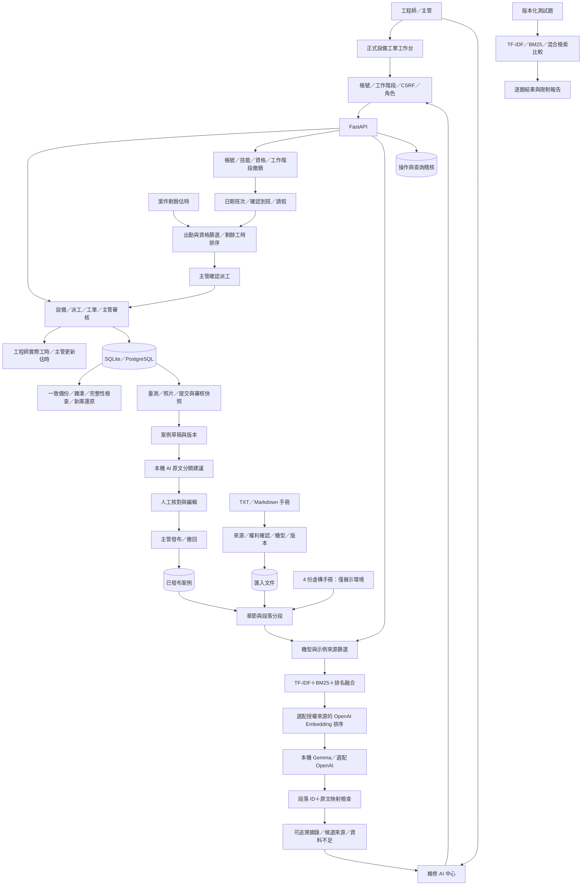

# PredictFix AI 維修系統架構

版本：2026-10-20。正式資料環境與展示環境分開；已支援真實資料建檔及維修流程，未接 CNC、PLC 或企業人事系統。部署與驗收限制見 [部署手冊](production-setup.md)。

## 介面與責任

單一工廠設備模板：設備建檔可選模板，自訂零件、量測欄位與排查／驗收項目；設備保存模板版本快照，更新模板不覆寫既有設備。流程頁以模板預填項目，仍由主管確認機型與依據後核准。詳見 [設備模板操作](equipment-templates.md)。

後續新增手機銘牌掃描、維修知識圖譜及外部工單介接；分別見 [手機掃描](../README.md)、[圖譜](knowledge-graph.md)、[工單介接](ticket-integration.md)。`/mobile.html` 是獨立靜態模擬流程，只在展示模式提供，與連接後端的 `/scan.html` 不同。

- `/`：正式模式為設備、工單、出勤派工、人員管理與操作紀錄；展示模式保留舊有設備模擬介面。展示聊天與感測器回放在正式模式關閉。
- `/api/admin/users`：帳號管理；`/api/duties`：排班與出勤；`/api/dispatch`：當班與剩餘工時推薦；`/api/tickets/{id}/estimate` 與 `/work-logs` 分開保存估時及實際工時。
- `/healthz`：不含敏感資料的服務／資料庫 readiness；`/api/health` 需要登入，提供模型與環境狀態。
- `/knowledge.html`：新的排查助手、手冊管理、案例草稿、發布與來源核對；共用既有登入。
- `/api/assist`：讀取可用來源、依機型篩選、檢索、本機 AI 選取原文、引用檢查及降級。
- `/api/knowledge/manuals`：內建與匯入文件；主管可新增版本或撤回匯入文件。未支援 PDF/OCR。
- `/api/tickets/{id}/case-draft`：只從已完成工單擷取草稿，保留原提交與審核快照。
- `/api/cases/{id}`：案例編輯與歷程；`publish`、`withdraw` 是獨立主管操作。
- `/api/cases/{id}/ai-suggestion`：本機模型從原維修文字分類摘錄，不自動保存。

## 資料與來源

`knowledge_documents` 保存不可覆寫的匯入版本與使用狀態。`repair_cases` 保存案例草稿、修訂版、來源快照、發布者與修改歷程。既有設備、工單、工作流程、照片、使用者與稽核表繼續使用。

未發布／撤回案例與撤回文件不進入新的檢索。機型未指定時顯示適用性待確認；指定機型時只檢索明確對應資料。未知實際 CNC 的型號不自動映射成虛構機型。

預設檢索融合 TF-IDF 與 BM25；啟用 OpenAI、請求模型輔助且來源獲授權時，可加入 Embedding 向量排序。外傳範圍與共用預算見 [OpenAI 整合](openai-integration.md)。本機模型已改用 Gemma；歷史 Qwen 與失敗的 QLoRA 實驗不代表目前服務模型。原文引用檢查確認模型選到有效段落，程式從來源取出原文，不能證明摘錄適合當下情境或診斷正確。模型不可用、格式錯誤或引用失敗時回傳候選來源。

## 驗證與限制

整合測試涵蓋文件版本、權限、機型篩選、撤回、案例發布、舊版本拒絕及虛構引用拒絕。`scripts/evaluate_retrieval.py` 比較三種檢索，資料集是開發用合成題，不是外部保留評估。

已支援日期排班／出勤與銘牌 OCR，但沒有 PDF／手冊 OCR、多模態維修診斷、PLC、RUL、企業 SSO 或跨公司資料隔離。Docker 與 PostgreSQL 的既有維修情境、重啟及備份還原已有驗證；新增圖譜與外部工單介接尚未完成 PostgreSQL 驗收。HTTPS 與真實企業串接仍待驗證。案例的發布是人工判斷，不構成原廠或法律認證。

安全驗證見 [專項測試與限制](security-testing.md)。工程師僅讀取已發布案例欄位及有效手冊；主管可讀草稿、撤回版本、來源快照與修改歷程。驗證錯誤不回傳原始輸入；模型段落選取在後端檢查欄位、型別與數量。引用有效仍不等於內容可信或診斷正確。
