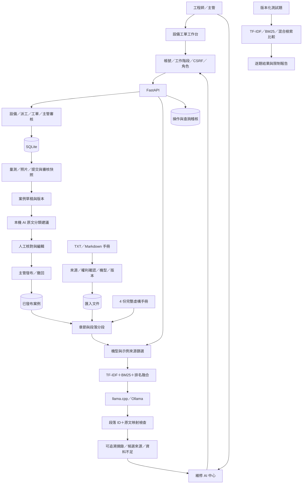

# PredictFix AI 維修系統架構

版本：2026-10-06。範圍為可本機運作的維修知識 MVP；未接真實 CNC、PLC 或企業人事系統。

## 介面與責任

- `/`：設備、工單、人员、維修分析與舊有對話查詢。原對話的 SQL 模板查詢保留。
- `/knowledge.html`：新的排查助手、手冊管理、案例草稿、發布與來源核對；共用既有登入。
- `/api/assist`：讀取可用來源、依機型篩選、檢索、本機 AI 選取原文、引用檢查及降級。
- `/api/knowledge/manuals`：內建與匯入文件；主管可新增版本或撤回匯入文件。未支援 PDF/OCR。
- `/api/tickets/{id}/case-draft`：只從已完成工單擷取草稿，保留原提交與審核快照。
- `/api/cases/{id}`：案例編輯與歷程；`publish`、`withdraw` 是獨立主管操作。
- `/api/cases/{id}/ai-suggestion`：本機模型從原維修文字分類摘錄，不自動保存。

## 資料與來源

`knowledge_documents` 保存不可覆寫的匯入版本與使用狀態。`repair_cases` 保存案例草稿、修訂版、來源快照、發布者與修改歷程。既有設備、工單、工作流程、照片、使用者與稽核表繼續使用。

未發布／撤回案例與撤回文件不進入新的檢索。機型未指定時顯示適用性待確認；指定機型時只檢索明確對應資料。未知實際 CNC 的型號不自動映射成虛構機型。

檢索融合的是兩種字詞方法，不是 Embedding 語意檢索。原文引用檢查確認模型選到有效段落，程式從來源取出原文，不能證明摘錄適合當下情境或診斷正確。模型不可用、格式錯誤或引用失敗時回傳候選來源，不偽稱已產生可靠建議。

## 驗證與限制

整合測試涵蓋文件版本、權限、機型篩選、撤回、案例發布、舊版本拒絕及虛構引用拒絕。`scripts/evaluate_retrieval.py` 比較三種檢索，資料集是開發用合成題，不是外部保留評估。

目前沒有 PDF/OCR、向量檢索、多模態診斷、PLC、實際排班、RUL、企業 SSO 或跨公司資料隔離。SQLite 本機單一工廠原型；Docker／PostgreSQL 全流程仍需另行驗證。案例的發布是人工判斷，不構成原廠或法律認證。
